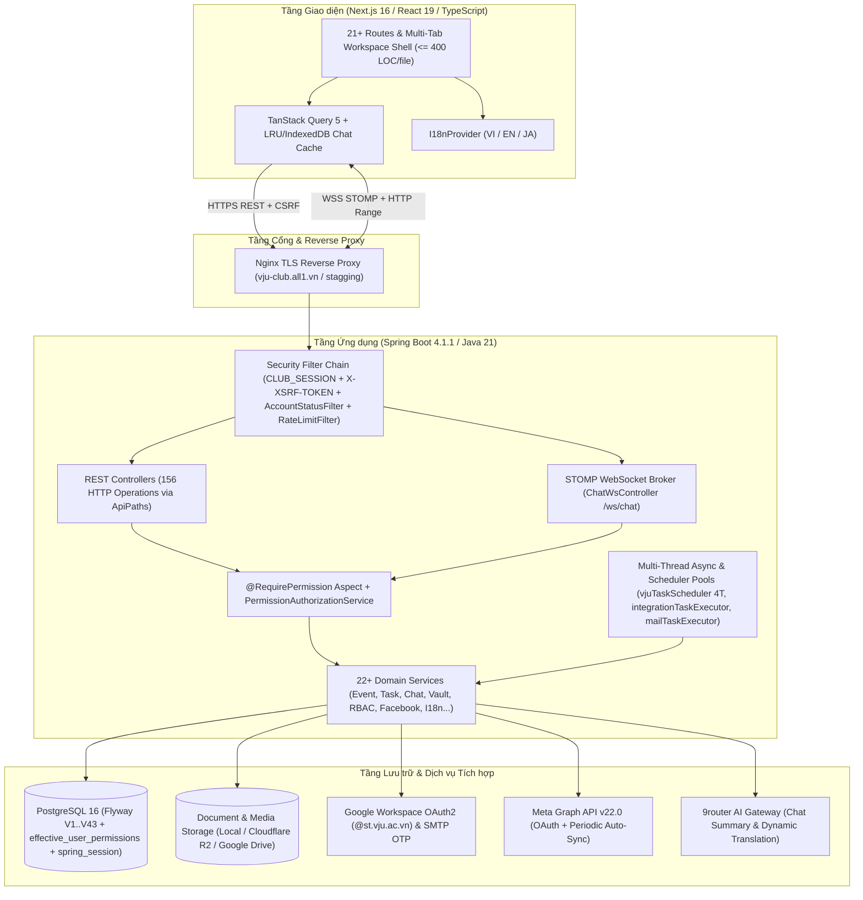
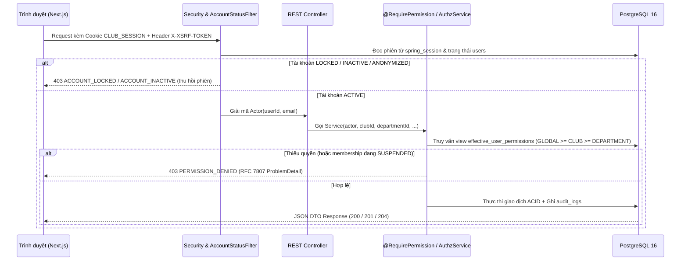

# Kiến trúc Hệ thống — CLUB-BASIC-VJU

Tài liệu này mô tả kiến trúc phân tầng 3 lớp nghiêm ngặt (*Zero Mock Data*), luồng xác thực – phân quyền 3 phạm vi và cơ chế giao tiếp thời gian thực của Hệ thống Quản lý CLB Sinh viên Trường Đại học Việt Nhật (`CLUB-BASIC-VJU`). Lý do lựa chọn và các phương án đã cân nhắc được ghi chi tiết tại [docs/decisions/README.md](../decisions/README.md).

---

## 1. Sơ đồ Kiến trúc Tổng thể (3-Tier + Realtime & Cloud Storage)

---

## 2. Nguyên tắc Ranh giới Phân tầng

### 2.1 Backend (`backend/springboot`)
1. **Ranh giới DTO bất biến:** `controller/` và `service/` chỉ trao đổi Java `record` (`dto/request`, `dto/response`). JPA `entity/` tuyệt đối không lộ ra khỏi tầng `service/impl`.
2. **MapStruct kiểm tra lúc biên dịch:** Mọi ánh xạ `Entity -> DTO` đi qua `mapper/` với `unmappedTargetPolicy = ERROR` — thêm trường vào DTO mà quên ánh xạ sẽ dừng biên dịch ngay lập tức.
3. **Tách `Actor` khỏi Spring Security ([ADR-002](../decisions/ADR-002-three-scope-rbac-and-effective-permissions-view.md)):** `ActorArgumentResolver` trích xuất danh tính người gọi từ phiên `CLUB_SESSION` và truyền tường minh vào Service, cho phép kiểm thử đơn vị Service độc lập.
4. **Hợp đồng API kép ([ADR-003](../decisions/ADR-003-dual-contract-openapi-governance-and-rfc7807.md)):** Mọi hằng số đường dẫn tập trung tại `common/ApiPaths.java` và đối chiếu tự động với `docs/api/openapi.yaml` + `docs/api/catalog.yml` qua 16 bài kiểm thử hợp đồng (`docs/api/tests/test_contract.py`).

### 2.2 Frontend (`frontend/`)
1. **Kiến trúc chia nhỏ `≤ 400` dòng/tệp ([ADR-006](../decisions/ADR-006-modular-nextjs-400-loc-and-cached-ai-i18n.md)):**
   - `src/app/`: Định tuyến Next.js App Router mỏng.
   - `src/components/<domain>/`: Các khung hiển thị, ngăn kéo (`Drawer`), hộp thoại (`Modal`) và thẻ tab quản trị (`OverviewTab`, `EventsTab`, `TasksTab`, `DocumentsTab`, `ChatTab`, `PositionsTab`...).
   - `src/hooks/<domain>/`: Quản lý trạng thái bất đồng bộ qua TanStack Query 5 và kết nối STOMP WebSocket (`useChatRealtime`, `useClubChat`).
   - `src/api/` & `src/forms/`: Tầng gọi API chuẩn hóa tự động gắn `X-XSRF-TOKEN` và quy tắc chỉ báo trường biểu mẫu (`form-field-meta.ts`).
2. **Hệ màu thiết kế 60/30/10 & Đa ngôn ngữ VI/EN/JA:** Kiểm định tự động bằng 36 bài unit test (`pnpm --dir frontend test`) đảm bảo không xuất hiện mã màu viết cứng hay lớp màu lệch bảng token.

---

## 3. Luồng Xử lý Trọng yếu

### 3.1 Xác thực Phiên, Kiểm tra Trạng thái & RBAC 3 Phạm vi

### 3.2 Đăng ký Sự kiện An toàn Đồng thời & Cô lập CTV ([ADR-004](../decisions/ADR-004-pessimistic-event-capacity-and-pii-anonymization.md))
- Khi sinh viên hoặc Cộng tác viên (`CTV`) gửi `POST /api/v1/events/{eventId}/registrations`, `EventServiceImpl` khóa dòng sự kiện bằng `PESSIMISTIC_WRITE` (`SELECT ... FOR UPDATE`), kiểm tra hạn `registration_deadline`, đối tượng mở nhận (`MEMBER` / `CTV`) và số chỗ còn lại (`capacity`) trước khi ghi `event_registrations`.
- Cộng tác viên ngoài CLB không phát sinh `memberships` hay `user_roles`, chỉ truy cập đúng nhiệm vụ sự kiện được giao trực tiếp (`assignee_id = actor.id()`).

### 3.3 Chat Thời gian thực & Kho Tài liệu 3 Tầng ([ADR-005](../decisions/ADR-005-realtime-stomp-chat-and-three-tier-document-vault.md))
- **Chat:** Tải lịch sử tin nhắn theo con trỏ (`cursor pagination`), kết hợp kênh đẩy thời gian thực STOMP (`/ws/chat`), luồng xem ảnh/video `HTTP Range` (`/api/v1/chat-attachments/{id}/stream`), mẫu phản hồi nhanh (`/quick-replies`) và ghim tin nhắn (`ChatPinnedBar`).
- **Kho tài liệu (`Document Vault`):** Phân tầng `SYSTEM` (toàn trường), `CLUB` (nội bộ CLB) và `DEPARTMENT` (riêng từng ban) với kiểm tra mã băm phiên bản và dọn tệp tự động nếu giao dịch DB rollback.

---

## 4. Môi trường Triển khai & Vận hành

| Môi trường | Giao diện Web | REST API / Swagger | Ngăn xếp Hạ tầng |
|---|---|---|---|
| **Production** | `https://vju-club.all1.vn` | `https://api.vju-club.all1.vn/swagger-ui.html` | Docker Compose độc lập (`:3110` / `:8110`), sao lưu `pg_dump` tự động `02:30` hằng ngày |
| **Stagging** | `https://stagging.vju-club.all1.vn` | `https://stagging.vju-club.all1.vn/swagger-ui.html` | Docker Compose & PostgreSQL tách biệt (`:3111` / `:8111`) |
| **Local Dev** | `http://localhost:3000` | `http://localhost:8080/swagger-ui.html` | `docker compose up -d postgres` + profile `local` |

Xem chi tiết quy trình CI/CD và khôi phục dữ liệu tại [docs/deploy/README.md](../deploy/README.md) và sơ đồ thực thể cơ sở dữ liệu tại [docs/erd/README.md](../erd/README.md).
