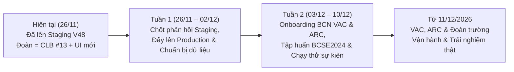

# Báo Cáo Hiện Trạng & Lộ Trình 2 Tuần (`26/11 – 10/12/2026`) Đưa VJU ClubHub Vào Vận Hành Thực Tế Cho Đoàn Trường, CLB VAC & CLB ARC

> **Kính gửi:** Chị Hương — Bí thư / Chủ nhiệm Đoàn Thanh niên Trường Đại học Việt Nhật (ĐHQGHN) & Ban Điều phối CLB  
> **Đơn vị thực hiện:** Đội phát triển `BCSE2023` (Chủ lực kỹ thuật hệ thống) & Đội triển khai kế cận `BCSE2024` (Học tập & Hỗ trợ vận hành CLB)  
> **Đầu mối 2 CLB thí điểm (Client):**  
> - **CLB VAC (Văn hoá Nghệ thuật / Vẽ — ~50 thành viên):** Nguyễn Thái Hoàng — Ban Chủ nhiệm VAC  
> - **CLB ARC (Học thuật & Nghiên cứu Khoa học — ~44 thành viên):** Phùng Thị Ngọc Bích — Ban Chủ nhiệm ARC  
> **Môi trường xem trước hiện tại:** https://staging.vju-club.all1.vn · **Môi trường chính thức:** https://vju-club.all1.vn  
> **Căn cứ tổng hợp:** Bộ hồ sơ Google Drive [Thư mục Sprint 3](https://drive.google.com/drive/folders/125SZM44KJKoyz_IO6NFvR0yD0Kcb9eMD) (*Phiếu phỏng vấn ARC & VAC 17/11*, *Báo cáo cuộc họp 20/11*, *Báo cáo hiện trạng 22/11*, *Feedback BĐP.pdf 23/11*, *Product Backlog 141 PBI*).

---

## 1. Tóm Tắt Điều Chỉnh Chiến Lược (Rút Ngắn Lộ Trình: `2 Tháng` → `2 Tuần`)

> [!IMPORTANT]
> **Mục tiêu trọng tâm:** Thay vì dàn trải phát triển trong 2 tháng, dự án khóa gọn phạm vi thực chiến trong **đúng 2 tuần (`26/11/2026 – 10/12/2026`)** để hoàn tất kiểm thử, chuẩn hóa dữ liệu thật và đưa **Đoàn Thanh niên (CLB thứ 13)** cùng **2 CLB đầu tàu (VAC & ARC)** vào **sử dụng thật 100%** từ ngày **`11/12/2026`**.

---

## 2. Rà Soát Tổng Thể "Đã Làm Được Gì vs. Còn Gì Chưa Xong" (Đối Chiếu Hồ Sơ Drive Sprint 3)

Qua đối chiếu toàn bộ 6 tài liệu gốc trong thư mục `Sprint 3` với bản dựng mới nhất trên `staging.vju-club.all1.vn` (đến bản cập nhật cơ sở dữ liệu `V48` sáng `26/11/2026`), nhóm đã hoàn thành **~90% khối lượng lập trình tính năng**; phần việc của 2 tuần tới tập trung vào **chốt quy chế biểu mẫu, kiểm thử di động, chuyển lên Production và nạp dữ liệu vận hành thật cho VAC & ARC**.

### 2.1. Các hạng mục ĐÃ HOÀN THÀNH KỸ THUẬT trên `staging.vju-club.all1.vn`

| Nhóm yêu cầu từ Tài liệu Sprint 3 | Nguồn căn cứ trên Drive | Trạng thái thực tế trên `staging.vju-club.all1.vn` |
| :--- | :--- | :--- |
| **1. Đưa Đoàn Thanh niên thành CLB thứ 13 (`DOANVJU`) & Phân quyền 4 tầng** | *Báo cáo cuộc họp 20/11* · *Feedback BĐP 23/11* (`PB-84`, `PB-85`) | **Đã lên Staging (`V35`, `V44`):** Khởi tạo đơn vị Đoàn + 3 ban trực thuộc; sửa dứt điểm lỗi tài khoản BCN chưa mặc định là thành viên `ACTIVE` (`BUG-P3-12`); có **Bộ chuyển đổi vị trí (`Unit Switcher`)** cho cán bộ kiêm nhiệm ĐTN ⇄ CLB trên cùng 1 tài khoản `@st.vju.ac.vn`. |
| **2. Tinh gọn Giao diện `/home`, Topbar, Menu 5 nhóm & Lọc sự kiện** | *Customer opinion (Diệu Linh)* · *Feedback BĐP 23/11* (`PB-87`) | **Đã lên Staging:** Đã gỡ thanh tìm kiếm trang thừa trên Topbar; gom Menu Quản trị còn 5 nhóm không chồng chéo; tách rõ **Sự kiện các CLB** (có bộ lọc theo 13 đơn vị + ảnh Poster `V48`) và **Lịch & Công việc cá nhân**; làm nổi khối nền nút `"Ứng tuyển CLB"`. |
| **3. Trang Portfolio CLB gắn Fanpage & Trang Ứng tuyển riêng có JD phân ban** | *Feedback BĐP 23/11* (`PB-89`, `PB-90`, `PB-94..96`) | **Đã lên Staging:** Mỗi CLB có trang Portfolio súc tích (`/clubs/[clubId]`) tự đồng bộ/nhúng Fanpage Facebook; bấm `"Ứng tuyển CLB"` mở trang riêng `/clubs/[clubId]/apply` hiển thị **Caption đợt tuyển + file mô tả công việc (JD) từng ban** thay cho khung nhỏ bên phải. |
| **4. Giải quyết 4 "nỗi đau" thực tế của CLB VAC & CLB ARC** | *Phiếu phỏng vấn ARC & VAC 17/11* (`PB-76..78`, `PB-88`) | **Đã lên Staging (`V36`, `V37`):** (1) Hẹn & nhắc lịch phỏng vấn tự động tránh ứng viên miss mail; (2) Kho tài liệu 3 tầng có chế độ bảo mật riêng cho BCN/Sổ Quỹ; (3) Kho biểu mẫu mượn phòng/CSVC; (4) Sự kiện Nội bộ CLB, giao Task có cảnh báo quá hạn & nộp file khóa theo deadline. |
| **5. Thống kê Đoàn trường, Biểu đồ GANTT, Giấy chứng nhận & Truy vết bảo mật** | *Báo cáo họp 20/11* · *Feedback BĐP 23/11* (`PB-86`, `PB-91..93`, `V44–V47`) | **Đã lên Staging:** Lịch sử sự kiện & **Giấy chứng nhận điện tử (`E-Certificate`)** trên `/profile`; biểu đồ **GANTT 13 đơn vị** chống trùng lịch; khảo sát 1–5 sao sau sự kiện; xuất báo cáo tham gia CSV/A4 theo MSSV; lưu vết IP/thiết bị, OTP 2FA & khoá sổ điểm danh `SHA-256`. |

### 2.2. Các hạng mục CHƯA XONG / CẦN HOÀN TẤT trong 2 tuần tới (`26/11 – 10/12/2026`)

| STT | Hạng mục còn thiếu / chưa chốt | Nguyên nhân / Hiện trạng | Hướng giải quyết dứt điểm trong 2 tuần |
| :---: | :--- | :--- | :--- |
| **1** | **Chưa đẩy bản `V35–V48` từ Staging sang Production (`vju-club.all1.vn`)** | Bản cập nhật lớn mới lên `staging.vju-club.all1.vn` để Đoàn và BCN xem duyệt giao diện trước. | Sau khi nhận góp ý nhanh trên Staging (Tuần 1), đội `BCSE2023` đóng gói kiểm thử và nâng cấp chính thức lên `vju-club.all1.vn`. |
| **2** | **14 hạng mục trên file `Product Backlog` chưa đóng nghiệm thu thực tế (UAT)** | Code đã xong trên Staging nhưng cần kiểm thử chéo trên điện thoại di động (iOS/Android) và luồng dữ liệu thật của CLB. | Đội QA `BCSE2023` hướng dẫn `BCSE2024` + đại diện VAC/ARC chạy kịch bản kiểm thử thực địa trên cả điện thoại và laptop, sửa ngay các lỗi hiển thị nhỏ. |
| **3** | **Chưa có dữ liệu thật của Đoàn, VAC & ARC (đang là dữ liệu mẫu)** | Danh sách thành viên thật (~50 TV VAC, ~44 TV ARC), phân ban, tài liệu kế thừa và Fanpage chính thức chưa nhập chuẩn. | Đội `BCSE2024` phối hợp trực tiếp với **Nguyễn Thái Hoàng (VAC)** và **Phùng Thị Ngọc Bích (ARC)** làm sạch dữ liệu mẫu, chuẩn hóa danh sách và nạp dữ liệu thật ở Tuần 2. |
| **4** | **Chờ Đoàn trường chốt 4 nội dung xác nhận & gửi bản mềm biểu mẫu chuẩn** | Mục `6.1 & 6.2` trong *Báo cáo hiện trạng 22/11* (quyền của Đoàn với 12 CLB, mẫu đơn mượn phòng chuẩn, mẫu minh chứng điểm danh, logo Đoàn). | Trình Chị Hương xác nhận ngay đầu Tuần 1 để cấu hình cứng vào phân hệ `DOANVJU` và Kho biểu mẫu dùng chung. |
| **5** | **Đào tạo chuyển giao cho nhóm `BCSE2024` & hướng dẫn sử dụng nhanh cho SV** | Thành viên `BCSE2024` và sinh viên 2 CLB cần tài liệu hướng dẫn ngắn gọn để không bỡ ngỡ khi chuyển từ Messenger/Sheets sang web. | Biên soạn bộ **Cẩm nang 1 trang PDF + Video 2 phút** cho 3 vai trò (Đoàn/BCN/Sinh viên) và tổ chức 1 buổi tập huấn cầm tay chỉ việc. |

> [!NOTE]
> **Các hạng mục thống nhất ĐỂ SANG GIAI ĐOẠN 2 (sau đợt thí điểm 2 tuần) để không làm chậm tiến độ:**
> 1. Hệ thống chấm **Điểm Rèn Luyện (ĐRL) tự động toàn trường** theo mô hình NEU/FTU *(trong đợt thí điểm 2 tuần này sử dụng ngay tính năng **Xuất bảng điểm danh QR có khoá sổ SHA-256 ra Excel/A4 & E-Certificate** làm minh chứng)*.
> 2. Quản lý công văn đến/đi cấp ĐHQGHN và phân quyền Bí thư/Lớp trưởng theo lớp hành chính.

---

## 3. Phân Công Vai Trò & Cơ Chế Phối Hợp: `BCSE2023` × `BCSE2024` × `VAC & ARC`

| Nhóm / Đầu mối | Vai trò chính trong chiến dịch 2 tuần | Đầu việc cụ thể chịu trách nhiệm |
| :--- | :--- | :--- |
| **Nhóm `BCSE2023`** *(Nhóm 3 — Chủ lực hệ thống)* | **Kiến trúc, Lập trình, Bảo mật & Vận hành máy chủ** | • Tiếp nhận phản hồi UI/UX trên `staging.vju-club.all1.vn` và tinh chỉnh code nhanh trong 24–48h. • Quản trị máy chủ, backup CSDL, cấu hình Email SMTP, QR Secret, Facebook Fanpage & nâng cấp lên `vju-club.all1.vn`. • Đào tạo kỹ thuật & quy trình nghiệp vụ cho nhóm `BCSE2024`; trực xử lý lỗi kỹ thuật tuyến 2 (Backend/Frontend/DB). |
| **Nhóm `BCSE2024`** *(Đội kế cận — Học & Hỗ trợ triển khai)* | **Triển khai thực địa, Chuẩn hóa dữ liệu, Kiểm thử UAT & Hỗ trợ CLB** | • Chia thành **2 tổ phụ trách chuyên biệt (Buddy Team)** đi cùng CLB VAC và CLB ARC. • Hỗ trợ BCN chuẩn hóa file danh sách thành viên (`@st.vju.ac.vn`), tạo cơ cấu Ban, tải biểu mẫu/tài liệu lên Kho lưu trữ và kết nối Fanpage. • Thực hiện kiểm thử trải nghiệm người dùng (đặc biệt trên điện thoại), viết hướng dẫn sử dụng nhanh và trực hỗ trợ tuyến 1 giải đáp thắc mắc cho thành viên CLB. |
| **Nguyễn Thái Hoàng** *(Client — BCN CLB VAC)* | **Đầu mối nghiệp vụ & Nghiệm thu thực tế CLB VAC** | • Cung cấp danh sách ~50 thành viên & phân công 3 ban (**Quản lý, Truyền thông, Chuyên môn**); cử 2–3 tài khoản BCN nhận quyền quản trị. • Duyệt giao diện Portfolio nghệ thuật/vẽ tranh của VAC, cấu hình Sổ Quỹ bảo mật BCN, và chủ trì **01 hoạt động/sự kiện hoặc đợt giao việc thật** của VAC trên hệ thống. |
| **Phùng Thị Ngọc Bích** *(Client — BCN CLB ARC)* | **Đầu mối nghiệp vụ & Nghiệm thu thực tế CLB ARC** | • Cung cấp danh sách ~44 thành viên (hợp nhất Gen 1 & Gen mới) theo 3 ban (**A-Plan, R-Chuyên môn, C-Content & Design**); cử 2–3 tài khoản BCN nhận quyền. • Tải bộ tài liệu kế thừa nhiệm kỳ & JD tuyển ban lên hệ thống; chủ trì **01 buổi sinh hoạt học thuật / điểm danh QR thật** của ARC trên hệ thống. |

---

## 4. Lộ Trình Triển Khai Chi Tiết Trong 2 Tuần (`26/11/2026 – 10/12/2026`)

### Tuần 1 (`26/11 – 02/12/2026`): Chốt Phản Hồi Staging, Khóa Biểu Mẫu Đoàn & Lên Sóng Production

| Mốc thời gian | Hạng mục công việc trọng tâm | Phối hợp thực hiện | Kết quả đầu ra (Deliverables) |
| :---: | :--- | :--- | :--- |
| **Ngày 1–2** `26/11 – 27/11` | **1. Rà soát trực tiếp trên `staging.vju-club.all1.vn` & Chốt 4 mục xác nhận với Đoàn:** • Mời Chị Hương, Ban Điều phối, Thái Hoàng (VAC) và Ngọc Bích (ARC) bấm thử luồng Đoàn = CLB thứ 13 & UI/UX mới trên Staging. • Tập huấn nhanh phiên đầu (60 phút) cho nhóm `BCSE2024` nắm toàn bộ luồng hệ thống và giao checklist kiểm thử di động. | `BCSE2023` chủ trì · `BCSE2024` + Thái Hoàng + Ngọc Bích tham gia | • Biên bản chốt góp ý tinh chỉnh UI cuối cùng trên Staging. • Tiếp nhận biểu mẫu mềm (đơn mượn phòng, quy chế) & danh sách email BCN Đoàn/VAC/ARC. |
| **Ngày 3–5** `28/11 – 30/11` | **2. Tinh chỉnh UI/UX đợt cuối & Kiểm thử toàn diện (Desktop + Mobile):** • `BCSE2023` xử lý dứt điểm mọi góp ý giao diện phát sinh từ buổi xem Staging; nạp biểu mẫu chuẩn của Đoàn vào hệ thống. • `BCSE2024` chạy kiểm thử thực tế 100% luồng Sinh viên & BCN trên điện thoại (trình duyệt trong Messenger/Safari/Chrome) và cập nhật kết quả cùng QA `BCSE2023`. | `BCSE2023` (Dev/QA) + `BCSE2024` (UAT) | • Đóng 100% lỗi giao diện tồn đọng (bao gồm `BUG-P3-12`). • Đồng bộ toàn bộ trạng thái hoàn thành lên `Product Backlog`. |
| **Ngày 6–7** `01/12 – 02/12` | **3. Nâng cấp chính thức lên Production (`vju-club.all1.vn`) & Làm sạch dữ liệu:** • Triển khai bản chính thức từ Staging sang `https://vju-club.all1.vn`, kích hoạt sao lưu CSDL tự động hằng ngày, cấu hình SMTP gửi mail `@st.vju.ac.vn` và khóa bảo mật QR. • Xóa dữ liệu nháp thử nghiệm, khởi tạo sạch 13 đơn vị (Đoàn Thanh niên + 12 CLB) và cấp quyền chính thức cho 2–3 tài khoản BCN của **Đoàn, VAC, ARC**. | `BCSE2023` (DevOps/BE) | • Trang chính thức `vju-club.all1.vn` vận hành ổn định bản mới nhất. • Tài khoản quản trị Đoàn, VAC, ARC đăng nhập & chuyển đổi vị trí mượt mà. |

### Tuần 2 (`03/12 – 10/12/2026`): Thiết Lập Không Gian Thật Cho VAC & ARC, Tập Huấn & Chạy Thử Nghiệm (Dry-Run)

| Mốc thời gian | Hạng mục công việc trọng tâm | Phối hợp thực hiện | Kết quả đầu ra (Deliverables) |
| :---: | :--- | :--- | :--- |
| **Ngày 8–10** `03/12 – 05/12` | **4. Thiết lập Không gian làm việc thật (Workspace Setup) cho Đoàn, VAC & ARC:** • **Tổ `BCSE2024` #1 + Nguyễn Thái Hoàng (VAC):** Nhập ~50 thành viên thật vào 3 ban (Quản lý, Truyền thông, Chuyên môn); tạo kênh Thông báo chung + kênh 3 ban (thay 6 nhóm Messenger); cập nhật ảnh Portfolio vẽ tranh, gắn Fanpage VAC và thiết lập thư mục Quỹ bảo mật BCN. • **Tổ `BCSE2024` #2 + Phùng Thị Ngọc Bích (ARC):** Nhập ~44 thành viên vào 3 ban (`A-Plan`, `R-Chuyên môn`, `C-Content & Design`); tải tài liệu kế thừa nhiệm kỳ lên Kho 3 tầng; cấu hình trang `/clubs/arc/apply` kèm Caption & file JD 3 ban. • **Đơn vị Đoàn (`DOANVJU`):** Đăng tải bộ biểu mẫu mượn phòng/CSVC chuẩn và kiểm tra lịch trình trên biểu đồ **GANTT**. | `BCSE2024` hỗ trợ nhập liệu · Thái Hoàng & Ngọc Bích duyệt · `BCSE2023` giám sát | • 3 không gian **Đoàn Thanh niên, VAC, ARC** có đầy đủ thành viên thật, kênh chat theo ban, kho tài liệu và trang Portfolio hoàn chỉnh. |
| **Ngày 11–12** `06/12 – 07/12` | **5. Hướng dẫn BCN & Tổ chức chạy thử 1 luồng hoạt động thật (Pilot Rehearsal):** • Phát hành **Bộ hướng dẫn nhanh 1 trang + Video 2 phút** cho thành viên CLB. • BCN **VAC** và **ARC** trực tiếp tạo **01 sự kiện / buổi sinh hoạt thật sắp tới** (hoặc đợt giao task sự kiện), gửi thông báo Email/In-App tới thành viên, thử quét mã **QR điểm danh**, khoá sổ `SHA-256` và xuất danh sách Excel/A4. | Thái Hoàng (VAC) · Ngọc Bích (ARC) · `BCSE2024` đồng hành · `BCSE2023` trực kỹ thuật | • 100% BCN VAC & ARC tự thao tác thành thạo không cần đội code làm thay. • Kiểm chứng thực tế luồng QR, Email, Task & Xuất báo cáo. |
| **Ngày 13–14** `08/12 – 10/12` | **6. Tinh chỉnh hậu chạy thử, Báo cáo nghiệm thu với Chị Hương & Mở Go-Live:** • Khắc phục ngay các vướng mắc nhỏ phát sinh từ buổi chạy thử của VAC & ARC. • Thiết lập kênh trực hỗ trợ nhanh (`BCSE2024` trực tuyến 1 – phản hồi trong 15 phút; `BCSE2023` trực tuyến 2). • Báo cáo kết quả sẵn sàng với Chị Hương & Ban Điều phối → **Chính thức bàn giao cho toàn bộ thành viên VAC & ARC sử dụng thật từ `11/12/2026`**. | Toàn đội `BCSE2023` + `BCSE2024` báo cáo Đoàn trường | • Biên bản bàn giao vận hành thực tế cho **VAC & ARC**. • Sẵn sàng mẫu chuẩn để nhân rộng sang 10 CLB còn lại sau tuần đầu vận hành. |

---

## 5. Tiêu Chí Đánh Giá Thành Công Khi Kết Thúc 2 Tuần (Mốc `10/12/2026`)

1. **Về mặt hệ thống (`BCSE2023` cam kết):** `https://vju-club.all1.vn` hoạt động ổn định 24/7, tốc độ phản hồi nhanh trên cả điện thoại và máy tính, bảo mật tài khoản `@st.vju.ac.vn` (có OTP 2FA, lưu vết IP và khoá sổ điểm danh `SHA-256`).
2. **Về mặt vận hành CLB (`VAC` & `ARC`):**
   - **CLB VAC (Nguyễn Thái Hoàng):** ~50 thành viên đăng nhập thành công, vận hành 3 ban trên hệ thống, giao việc có hạn chót và điểm danh QR tối thiểu 01 buổi hoạt động thật thay cho Google Sheet rời rạc.
   - **CLB ARC (Phùng Thị Ngọc Bích):** ~44 thành viên đăng nhập thành công, quy hoạch gọn tài liệu kế thừa nhiệm kỳ & kênh trao đổi 3 ban A-R-C, sẵn sàng mẫu trang ứng tuyển có JD phân ban và điểm danh QR tối thiểu 01 buổi sinh hoạt thật.
3. **Về phía Đoàn Thanh niên (`DOANVJU`) & Đội kế cận (`BCSE2024`):**
   - Đoàn trường theo dõi trực quan lịch hoạt động của Đoàn – VAC – ARC trên biểu đồ **GANTT**, xuất được danh sách điểm danh chuẩn phục vụ xác nhận tham gia.
   - Đội `BCSE2024` nắm vững quy trình hỗ trợ triển khai để sẵn sàng nhân rộng mô hình từ 2 CLB thí điểm lên đủ **12 CLB toàn trường** ở giai đoạn kế tiếp.

---

## 6. Bốn Nội Dung Kính Nhờ Chị Hương Cho Ý Kiến Xác Nhận Để Nhóm Khóa Cấu Hình Tuần 1

1. **Phạm vi quyền của tài khoản Đoàn / Ban Điều phối đối với các CLB:** Trong đợt thí điểm này, tài khoản Đoàn Thanh niên quản lý trọn vẹn đơn vị thứ 13 (`DOANVJU`) và **xem thống kê tổng hợp / lịch GANTT của các CLB**, hay cần mở thêm quyền **phê duyệt / tạm dừng sự kiện của CLB**?
2. **Danh sách tài khoản đại diện Đoàn Thanh niên (`2–3 tài khoản @st.vju.ac.vn`):** Kính nhờ Chị Hương cung cấp email trường của các anh/chị phụ trách đơn vị Đoàn trên hệ thống để nhóm phân quyền chính danh ngay khi lên Production (`01/12/2026`).
3. **Bản mềm biểu mẫu chuẩn dùng chung:** Kính nhờ Đoàn gửi giúp bản mềm **Mẫu đơn xin mượn phòng / cơ sở vật chất** và **Quy chế / Biểu mẫu báo cáo hoạt động CLB** để nhóm gắn sẵn vào Kho biểu mẫu cho VAC và ARC tải dùng ngay.
4. **Chấp thuận mẫu xuất danh sách điểm danh thí điểm:** Xác nhận bảng xuất Excel / bản in A4 từ dữ liệu quét QR (có Họ tên, MSSV, thời gian check-in và mã khoá sổ điện tử `SHA-256`) được dùng làm minh chứng tham gia hoạt động hợp lệ cho sinh viên trong giai đoạn thí điểm của VAC và ARC.
