# Sơ đồ Thực thể Liên kết (ERD) — PostgreSQL 16 (`Flyway V1..V45`)

Tài liệu này mô hình hóa cấu trúc quan hệ giữa các bảng cốt lõi trong cơ sở dữ liệu PostgreSQL 16 của hệ thống `CLUB-BASIC-VJU` (quản lý qua **45 bản migration Flyway** từ `V1` đến `V45`). Danh mục chi tiết từng bản migration và các ràng buộc `CHECK` / `TRIGGER` xem tại [docs/database/README.md](../database/README.md).

---

## 1. Sơ đồ ERD Tổng hợp theo Miền Nghiệp vụ

```mermaid
erDiagram
    USERS ||--o{ MEMBERSHIPS : "tham gia CLB"
    USERS ||--o{ USER_ROLES : "được gán vai trò"
    USERS ||--o{ USER_PERMISSIONS : "được cấp quyền lẻ"
    USERS ||--o{ CLUB_APPLICATIONS : "nộp đơn ứng tuyển"
    USERS ||--o{ EVENT_REGISTRATIONS : "đăng ký Member/CTV"
    USERS ||--o{ TASKS : "nhận việc (assignee)"
    USERS ||--o{ NOTIFICATIONS : "nhận thông báo"
    USERS ||--o{ AUDIT_LOGS : "thực hiện hành động"
    USERS ||--o{ EVENTS : "chốt điểm danh (attendance_locked_by, V44)"
    USERS ||--o{ EVENT_FEEDBACKS : "đánh giá sự kiện (V44)"
    USERS ||--o{ SECURITY_OTPS : "mã OTP 2FA (V44)"

    CLUBS ||--o{ DEPARTMENTS : "chia thành các ban"
    CLUBS ||--o{ MEMBERSHIPS : "quản lý thành viên"
    CLUBS ||--o{ CLUB_APPLICATION_FORMS : "cấu hình form tuyển"
    CLUBS ||--o{ CLUB_APPLICATIONS : "tiếp nhận đơn"
    CLUBS ||--o{ EVENTS : "tổ chức sự kiện"
    CLUBS ||--o{ TASKS : "giao nhiệm vụ"
    CLUBS ||--o{ DOCUMENTS : "kho tài liệu CLB"
    CLUBS ||--o{ CHAT_CHANNELS : "kênh giao tiếp"
    CLUBS ||--o{ CHAT_QUICK_REPLIES : "mẫu tin nhắn nhanh"
    CLUBS ||--o| CLUB_FACEBOOK_PAGES : "kết nối Fanpage Facebook (V38)"
    CLUBS ||--o{ CLUB_FACEBOOK_POSTS : "cache bài viết Fanpage (V38)"
    EVENTS ||--o{ EVENT_SUBMISSIONS : "nộp hồ sơ sự kiện (V37)"
    EVENTS ||--o{ EVENT_FEEDBACKS : "khảo sát sau sự kiện (V44)"
    CHAT_MESSAGES ||--o{ CHAT_MESSAGE_REACTIONS : "cảm xúc tin nhắn (V31)"
    USERS ||--o{ PASSWORD_RESET_OTPS : "mã OTP đặt lại mật khẩu (V33)"

    DEPARTMENTS ||--o{ DEPARTMENT_MEMBERS : "xếp nhân sự ban"
    MEMBERSHIPS ||--o{ DEPARTMENT_MEMBERS : "gắn với membership ACTIVE"
    DEPARTMENTS ||--o{ DOCUMENTS : "kho tài liệu Ban"
    DEPARTMENTS ||--o{ CHAT_CHANNELS : "kênh chat Ban"

    ROLES ||--o{ ROLE_PERMISSIONS : "gom nhóm quyền"
    PERMISSIONS ||--o{ ROLE_PERMISSIONS : "thuộc vai trò"
    ROLES ||--o{ USER_ROLES : "gán theo scope"
    PERMISSIONS ||--o{ USER_PERMISSIONS : "cấp theo scope"

    CLUB_APPLICATION_FORMS ||--o{ CLUB_APPLICATIONS : "áp dụng mẫu đơn"
    CLUB_APPLICATIONS ||--o{ CLUB_APPLICATION_FILES : "đính kèm minh chứng"

    EVENTS ||--o{ EVENT_REGISTRATIONS : "ghi nhận đăng ký"
    EVENT_REGISTRATIONS ||--o| EVENT_ATTENDANCES : "điểm danh & hậu kiểm"
    EVENTS ||--o{ TASKS : "nhiệm vụ sự kiện"

    TASKS ||--o{ TASKS : "phân rã subtask 1 cấp (parent_task_id)"

    DOCUMENTS ||--o{ DOCUMENT_VERSIONS : "lưu lịch sử phiên bản"

    CHAT_CHANNELS ||--o{ CHAT_MESSAGES : "chứa tin nhắn"
    CHAT_CHANNELS ||--o{ CHAT_CHANNEL_READS : "trạng thái đã đọc"
    CHAT_MESSAGES ||--o{ CHAT_MESSAGES : "trả lời (reply_to_id)"
    CHAT_MESSAGES ||--o{ CHAT_MESSAGE_ATTACHMENTS : "đính kèm ảnh/video/tệp"
    DOCUMENTS ||--o{ CHAT_MESSAGES : "đính kèm tài liệu kho"
    CHAT_CHANNELS ||--o{ AI_SUMMARIES : "tóm tắt hội thoại AI"

    USERS {
        uuid id PK
        varchar email UK "lower(email) unique"
        varchar student_code UK "lower(student_code) unique"
        varchar status "ACTIVE | LOCKED | INACTIVE"
        varchar google_subject UK "OAuth @st.vju.ac.vn"
        timestamptz anonymized_at "Ẩn danh PII (V21)"
        boolean email_notifications_enabled "Nhận email cảnh báo (V44)"
        boolean two_factor_enabled "OTP 2FA tùy chọn Tầng 1-3 (V44)"
    }

    CLUBS {
        uuid id PK
        varchar code UK "lower(code) unique"
        varchar name
        varchar status "ACTIVE | INACTIVE"
        varchar logo_storage_key "V22"
        varchar cover_storage_key "V22"
        text overview_config "JSONB object (V27)"
        varchar facebook_url "Fanpage fallback Page Plugin (V44)"
    }

    DEPARTMENTS {
        uuid id PK
        uuid club_id FK "Composite UK (club_id, lower(name))"
        varchar name
        varchar status "ACTIVE | INACTIVE"
    }

    MEMBERSHIPS {
        uuid id PK
        uuid user_id FK
        uuid club_id FK
        varchar status "ACTIVE | SUSPENDED | LEFT"
        timestamptz joined_at
        timestamptz left_at "Chỉ khác NULL khi LEFT"
    }

    EVENTS {
        uuid id PK
        uuid club_id FK
        varchar status "DRAFT | OPEN | CLOSED | COMPLETED | CANCELLED"
        int capacity "Khóa bi quan khi đăng ký"
        timestamptz registration_deadline
        timestamptz completed_at "Mốc tính cửa sổ hậu kiểm (V21)"
        varchar academic_term "Học kỳ ĐRL YYYY-1|2|3 (V44)"
        timestamptz attendance_locked_at "Chốt sổ điểm danh (V44)"
        uuid attendance_locked_by FK "ON DELETE RESTRICT (V44)"
        varchar attendance_signature_sha256 "Chữ ký SHA-256 (V44)"
    }

    EVENT_FEEDBACKS {
        uuid id PK
        uuid event_id FK "ON DELETE CASCADE (V44)"
        uuid user_id FK "ON DELETE RESTRICT; UK(event_id, user_id) (V44)"
        int rating "1..5 sao"
        varchar comment "Tối đa 1000 ký tự"
        timestamptz created_at
    }

    SECURITY_OTPS {
        uuid id PK
        uuid user_id FK "ON DELETE CASCADE (V44)"
        varchar purpose "LOGIN_2FA | CRITICAL_ACTION"
        varchar action_context
        varchar otp_hash
        timestamptz expires_at
        int attempts
        int max_attempts "1..15"
        timestamptz consumed_at
        timestamptz invalidated_at
    }

    AUDIT_LOGS {
        uuid id PK
        uuid actor_user_id FK "ON DELETE RESTRICT"
        varchar action
        varchar resource_type
        uuid resource_id
        uuid club_id FK
        varchar ip_address "X-Forwarded-For (V44)"
        varchar user_agent "V44"
        timestamptz created_at
    }

    EVENT_REGISTRATIONS {
        uuid id PK
        uuid event_id FK
        uuid user_id FK
        varchar participant_type "MEMBER | CTV"
        varchar event_role "Vai trò nhân sự sự kiện (V21)"
        varchar status "REGISTERED | CANCELLED"
    }

    EVENT_ATTENDANCES {
        uuid id PK
        uuid registration_id FK
        varchar status "PRESENT | LATE | ABSENT | EXCUSED"
        varchar edit_reason "Lý do sửa sau COMPLETED (V21)"
        bigint version "Optimistic Lock @Version"
    }

    TASKS {
        uuid id PK
        uuid club_id FK
        uuid department_id FK
        uuid event_id FK
        uuid parent_task_id FK "Tối đa 1 cấp subtask (V21)"
        uuid assignee_id FK "1 người phụ trách chính"
        varchar status "TODO | IN_PROGRESS | DONE | CANCELLED"
        int progress_percent "0..100"
        timestamptz due_at
        timestamptz overdue_notified_at "Cảnh báo quá hạn idempotent"
    }

    DOCUMENTS {
        uuid id PK
        varchar scope "SYSTEM | CLUB | DEPARTMENT (V25)"
        uuid club_id FK "NULL khi scope = SYSTEM"
        uuid department_id FK "Khác NULL khi scope = DEPARTMENT"
        varchar visibility "PUBLIC_INTERNAL | OFFICERS | MEMBERS | DEPARTMENT_ONLY"
        boolean deleted "Xóa mềm hỗ trợ khôi phục"
    }

    CHAT_MESSAGES {
        uuid id PK
        uuid channel_id FK
        uuid sender_id FK
        uuid reply_to_id FK "V25"
        uuid document_id FK "V25"
        boolean pinned "Ghim tin nhắn kiểu Messenger (V29)"
        timestamptz pinned_at
        uuid pinned_by FK
    }
```

---

## 2. Các Bảng Hạ tầng & Cấu hình Độc lập

Ngoài các thực thể liên kết ở trên, cơ sở dữ liệu duy trì các bảng/view chuyên trách phục vụ phiên đăng nhập, cấu hình vận hành, bảo mật OTP, đa ngôn ngữ và kiểm toán:

| Bảng / View | Bản Migration | Vai trò trong kiến trúc |
|---|---|---|
| **`effective_user_permissions` *(View)*** | `V5`, `V20` | Hợp nhất quyền trực tiếp (`user_permissions`) và quyền qua vai trò (`user_roles`), tự động loại bỏ quyền cấp `CLUB`/`DEPARTMENT` nếu người dùng đang bị `SUSPENDED` tại CLB đó. |
| **`spring_session` & `spring_session_attributes`** | `V12` | Lưu phiên HTTP bền vững phía máy chủ (`CLUB_SESSION`), cho phép thu hồi phiên tức thì khi khóa/vô hiệu hóa/ẩn danh tài khoản ([ADR-001](../decisions/ADR-001-postgresql-stateful-sessions-and-csrf.md)). |
| **`system_settings`** | `V19`, `V21`, `V24`, `V33`, `V39`, `V41`, `V43` | Bảng cấu hình đơn dòng lưu các ngưỡng vận hành, hạn mức chống lạm phát, chính sách OTP/SMTP, cấu hình tích hợp động (Facebook OAuth, AI Gateway, Google SSO mã hoá AES-256-GCM) và chu kỳ đồng bộ Facebook tự động (`facebook_auto_sync_enabled`, `facebook_auto_sync_interval_minutes`). |
| **`club_facebook_pages` & `club_facebook_posts`** | `V38`, `V42`, `V43` | Lưu liên kết Fanpage theo từng CLB (Page Access Token mã hoá AES-256-GCM, `consecutive_sync_failures`, `last_auto_synced_at`) và bộ đệm bài viết/tương tác đồng bộ định kỳ từ Meta Graph API. |
| **`event_co_hosts` & Phân cấp Lễ hội Đa CLB** | `V49` | Bảng liên kết nhiều-nhiều giữa `events` và `clubs` cho các sự kiện đồng tổ chức; kết hợp `events.parent_event_id` (1 cấp), `booth_code` (`uq_events_parent_booth_code`), `venue_map_url`, `facebook_post_url`, `recap_album_url` và `allow_shuttle_bus` / `event_registrations.needs_shuttle_bus`. |
| **`password_reset_otps`** | `V33` | Lưu mã băm OTP 6 chữ số có thời hạn & giới hạn số lần thử cho luồng khôi phục mật khẩu qua SMTP. |
| **`security_otps`** | `V44` | Lưu mã băm OTP 6 chữ số theo `purpose` (`LOGIN_2FA` / `CRITICAL_ACTION`) và `action_context` cho luồng xác thực 2 bước tùy chọn / thao tác trọng yếu của tài khoản quản trị Tầng 1–3. |
| **`i18n_translations`** | `V23` | Bộ nhớ đệm bản dịch AI bền vững theo cặp khóa duy nhất `(source_hash, target_locale)` phục vụ đa ngôn ngữ `vi`/`en`/`ja` ([ADR-006](../decisions/ADR-006-modular-nextjs-400-loc-and-cached-ai-i18n.md)). |
| **`audit_logs` & `permission_audit_logs`** | `V1`, `V6`, `V44` | Nhật ký kiểm toán chỉ-ghi-thêm (*append-only* qua trigger PostgreSQL), lưu giá trị JSON trước/sau cùng `ip_address` (tôn trọng `X-Forwarded-For`) và `user_agent` của mọi thao tác quản trị. |

---

## 3. Ràng buộc Khóa ngoại Chống Mất Lịch sử (`ON DELETE RESTRICT`)

Theo [ADR-004](../decisions/ADR-004-pessimistic-event-capacity-and-pii-anonymization.md), các bảng nghiệp vụ lịch sử (`club_applications`, `event_registrations`, `event_attendances`, `event_feedbacks`, `events.attendance_locked_by`, `tasks`, `documents`, `chat_messages`, `ai_summaries`, `audit_logs`, `permission_audit_logs`) đều sử dụng `ON DELETE RESTRICT` khi tham chiếu tới `users`, `clubs` và `departments`:
- **CLB và Ban** không bao giờ xóa vật lý mà chuyển trạng thái `INACTIVE`.
- **Tài khoản người dùng** đã có dữ liệu lịch sử được ẩn danh PII tại chỗ (`users.anonymized_at IS NOT NULL`) thay vì xóa dòng vật lý, giữ toàn vẹn tuyệt đối mọi số liệu thống kê qua các nhiệm kỳ CLB.
