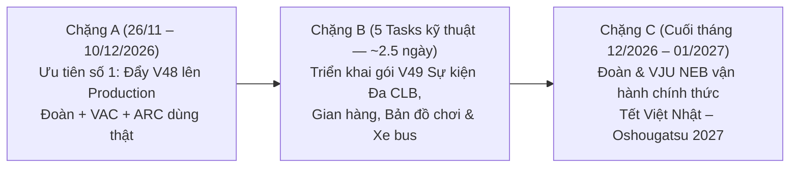

# Kế Hoạch Chi Tiết: Hệ Thống Sự Kiện Đa CLB, Gian Hàng Lễ Hội & Chiến Dịch 4 Chặng Chuẩn VJU (`Flyway V49`)

> **For agentic workers:** REQUIRED SUB-SKILL: Use `superpowers:subagent-driven-development` (recommended) or `superpowers:executing-plans` to implement this plan task-by-task. Steps use checkbox (`- [ ]`) syntax for tracking.

**Goal:** Nâng cấp phân hệ Sự kiện của **VJU ClubHub** để vận hành trọn vẹn các lễ hội đa CLB thực tế trên Fanpage `facebook.com/vnu.vju` (*Tết Việt Nhật – Oshougatsu, Welcome Ceremony, Club Day, VJU Japan Festival, Open Campus, Sweet Heart Days*), bao gồm: **Sự kiện mẹ cấp trường → Gian hàng CLB con (`parent_event_id` + `booth_code` chống trùng ô vị trí)**, **Đồng tổ chức nhiều CLB (`event_co_hosts`)**, **Ảnh “Bản đồ chơi” (`venue_map_url`)**, **Đăng ký xe bus Mỹ Đình ↔ Hòa Lạc (`allow_shuttle_bus` / `needs_shuttle_bus`)**, và **Liên kết Chiến dịch 4 Chặng (`facebook_post_url`, `recap_album_url`)**.

**Architecture:** Mở rộng nhẹ trên bảng `events` và `event_registrations` hiện hữu qua duy nhất 1 migration `V49__festival_booths_shuttle_and_campaign_links.sql` kèm bảng liên kết `event_co_hosts` (có đầy đủ FK index đạt chuẩn `DatabaseConstraintsTest` và partial unique index khóa trùng `booth_code`). Logic nghiệp vụ Backend tách riêng vào `EventFestivalSupport.java` (~180 dòng) để không làm phình `EventServiceImpl.java`; giao diện Frontend tách thành 2 component mới độc lập (`EventFestivalCampaignFields.tsx`, `EventFestivalDetailSection.tsx`, mỗi tệp `< 200` dòng) đảm bảo toàn bộ tệp UI giữ nguyên dưới ngưỡng `< 400` dòng.

**Tech Stack:** Spring Boot 3.4 (Java 21), PostgreSQL 16 + Flyway `V49`, MapStruct, OpenAPI 3.1 Dual-Contract, Next.js 16 (React 19, TypeScript, TanStack Query v5, Tailwind CSS 60/30/10 palette).

**Spec:** [He-Sinh-Thai-Su-Kien-VJU-Tu-Facebook-2026-11-26.md](file:///Volumes/D/club_vju/docs/feedback/He-Sinh-Thai-Su-Kien-VJU-Tu-Facebook-2026-11-26.md) & [lo-trinh-2-tuan-bao-cao-chi-huong-2026-11-26.md](file:///Volumes/D/club_vju/docs/baseline/lo-trinh-2-tuan-bao-cao-chi-huong-2026-11-26.md)

---

## Khớp Nối Tiến Độ Với Lộ Trình 2 Tuần (`VAC & ARC`) Và Mùa `Oshougatsu 2027`



> [!IMPORTANT]
> **Nguyên tắc không làm trễ Go-Live 2 tuần (`26/11 – 10/12/2026`):**
> 1. **Không trộn code `V49` trước khi chốt nâng cấp `V48` lên Production (`01–02/12/2026`)** cho Đoàn, VAC (Nguyễn Thái Hoàng) và ARC (Phùng Thị Ngọc Bích).
> 2. Ngay sau khi `vju-club.all1.vn` ổn định (hoặc chạy song song bởi đội `BCSE2023` trong Tuần 2 khi `BCSE2024` đang nhập liệu CLB), triển khai gọn **5 Tasks của gói `V49`** dưới đây để kịp phục vụ **Tết Việt Nhật – Oshougatsu 2027 (tháng 01/2027)**.

---

## Global Constraints (Bắt Buộc Tuân Thủ Ở Mọi Task)

- **Giới hạn kích thước tệp:** Mọi tệp trong `frontend/src/{components,hooks,api,forms,lib,utils}` phải **`< 400` dòng** (`EventParticipationDrawers.tsx` đang `390` dòng, `EventsPortalView.tsx` đang `393` dòng, `EventsTab.tsx` đang `394` dòng → **tuyệt đối không nhồi thêm logic trực tiếp vào 3 tệp này**, chỉ gọi sub-component tách riêng).
- **Bảng màu 60/30/10:** Chỉ dùng token chuẩn (`bg-background`, `bg-card`, `bg-muted`, `text-foreground`, `text-muted-foreground`, `text-primary`, `border-border`); cấm các màu Tailwind ngoài hệ thống (`blue`, `emerald`, `purple`, `indigo`, `teal`, `cyan`, `orange`...).
- **Ràng buộc CSDL (`DatabaseConstraintsTest`):** Mọi cột khóa ngoại (`parent_event_id`, `event_co_hosts.club_id`) **bắt buộc phải có `CREATE INDEX`**.
- **Hằng số API (`ApiPaths.java`) & Dual OpenAPI Contract:** Không hardcode chuỗi đường dẫn trong Controller; đồng bộ 100% giữa `docs/api/openapi.yaml` ↔ `backend/springboot/src/main/resources/api/phase1-openapi.yaml` và `docs/api/catalog.yml` ↔ `backend/springboot/src/main/resources/api/catalog.yml`.
- **Tương thích ngược kiểm thử:** Giữ nguyên các constructor phụ của `CreateEventRequest`, `UpdateEventRequest`, `EventRegistrationRequest`, `EventResponse` để không làm gãy `680+` test hiện hữu.

---

## Bản Đồ Tệp Tạo Mới & Chỉnh Sửa (File Structure)

| Phân tầng | Tệp tạo mới (`Create`) | Tệp chỉnh sửa (`Modify`) |
| :--- | :--- | :--- |
| **Database (`V49`)** | `backend/springboot/src/main/resources/db/migration/V49__festival_booths_shuttle_and_campaign_links.sql` | `docs/database/README.md`, `docs/erd/README.md` |
| **Backend (`Spring Boot`)** | • `dto/response/EventCoHostResponse.java`<br>• `service/impl/EventFestivalSupport.java`<br>• `test/.../integration/FestivalMultiClubEventApiTest.java` | • `common/ApiPaths.java`<br>• `entity/Event.java`, `entity/EventRegistration.java`<br>• `repository/EventRepository.java`<br>• `dto/request/CreateEventRequest.java`, `UpdateEventRequest.java`, `EventRegistrationRequest.java`<br>• `dto/response/EventResponse.java`, `EventRegistrationResponse.java`, `EventsTimelineResponse.java`<br>• `mapper/EventMapper.java`<br>• `service/EventService.java`, `service/impl/EventServiceImpl.java`, `EventsTimelineServiceImpl.java`<br>• `controller/EventController.java` |
| **API Contract** | — | • `docs/api/openapi.yaml` & `backend/.../api/phase1-openapi.yaml`<br>• `docs/api/catalog.yml` & `backend/.../api/catalog.yml` |
| **Frontend (`Next.js`)** | • `components/event/EventFestivalCampaignFields.tsx`<br>• `components/event/EventFestivalDetailSection.tsx`<br>• `tests/festival-events.test.ts` | • `types/event/event.types.ts`, `types/statistics/statistics.types.ts`<br>• `api/event/events.api.ts`, `lib/api/query-keys.ts`<br>• `forms/event/event-form.ts`<br>• `components/event/EventManagementModals.tsx`<br>• `components/event/EventParticipationDrawers.tsx`<br>• `components/event/EventAttendanceRosterSection.tsx`<br>• `components/event/EventsGanttView.tsx`<br>• `utils/export/club-reports.ts`<br>• `i18n/phrases-en-workspace.ts`, `phrases-ja-workspace.ts` |

---

### Task 1: Schema Flyway `V49` & Ràng Buộc Cơ Sở Dữ Liệu (Sự Kiện Mẹ – Gian Hàng Con, Đồng Tổ Chức, Bản Đồ Chơi & Xe Bus)

**Files:**
- Create: `backend/springboot/src/main/resources/db/migration/V49__festival_booths_shuttle_and_campaign_links.sql`
- Modify: `backend/springboot/src/main/java/com/vju/club/entity/Event.java`
- Modify: `backend/springboot/src/main/java/com/vju/club/entity/EventRegistration.java`
- Modify: `backend/springboot/src/main/java/com/vju/club/repository/EventRepository.java`
- Test: `backend/springboot/src/test/java/com/vju/club/integration/DatabaseConstraintsTest.java`

**Interfaces:**
- Produces:
  - SQL columns on `events`: `parent_event_id UUID`, `booth_code VARCHAR(32)`, `venue_map_url VARCHAR(500)`, `facebook_post_url VARCHAR(500)`, `recap_album_url VARCHAR(500)`, `allow_shuttle_bus BOOLEAN NOT NULL DEFAULT FALSE`
  - SQL table: `event_co_hosts (event_id UUID, club_id UUID)`
  - SQL column on `event_registrations`: `needs_shuttle_bus BOOLEAN NOT NULL DEFAULT FALSE`
  - Repository methods on `EventRepository`: `findByParentEventIdAndStatusNotOrderByBoothCodeAscStartTimeAsc(UUID parentEventId, EventStatus excludedStatus)`

- [ ] **Step 1: Tạo migration `V49__festival_booths_shuttle_and_campaign_links.sql`**

```sql
-- V49: Multi-club festival hierarchy (parent_event_id + booth_code), co-host clubs,
--      venue/booth map ("Bản đồ chơi"), 4-stage Facebook campaign links, and Mỹ Đình <-> Hòa Lạc shuttle bus flag.

ALTER TABLE events
    ADD COLUMN IF NOT EXISTS parent_event_id UUID REFERENCES events(id) ON DELETE SET NULL,
    ADD COLUMN IF NOT EXISTS booth_code VARCHAR(32),
    ADD COLUMN IF NOT EXISTS venue_map_url VARCHAR(500),
    ADD COLUMN IF NOT EXISTS facebook_post_url VARCHAR(500),
    ADD COLUMN IF NOT EXISTS recap_album_url VARCHAR(500),
    ADD COLUMN IF NOT EXISTS allow_shuttle_bus BOOLEAN NOT NULL DEFAULT FALSE,
    ADD CONSTRAINT ck_events_not_self_parent CHECK (parent_event_id IS NULL OR parent_event_id <> id);

CREATE INDEX IF NOT EXISTS idx_events_parent_event_id
    ON events (parent_event_id);

-- Prevent duplicate booth slot assignment under the same active parent festival
CREATE UNIQUE INDEX IF NOT EXISTS uq_events_parent_booth_code
    ON events (parent_event_id, UPPER(BTRIM(booth_code)))
    WHERE parent_event_id IS NOT NULL
      AND booth_code IS NOT NULL
      AND BTRIM(booth_code) <> ''
      AND status <> 'CANCELLED';

CREATE TABLE IF NOT EXISTS event_co_hosts (
    event_id UUID NOT NULL REFERENCES events(id) ON DELETE CASCADE,
    club_id  UUID NOT NULL REFERENCES clubs(id) ON DELETE CASCADE,
    created_at TIMESTAMPTZ NOT NULL DEFAULT NOW(),
    PRIMARY KEY (event_id, club_id)
);

CREATE INDEX IF NOT EXISTS idx_event_co_hosts_club_id
    ON event_co_hosts (club_id);

ALTER TABLE event_registrations
    ADD COLUMN IF NOT EXISTS needs_shuttle_bus BOOLEAN NOT NULL DEFAULT FALSE;
```

- [ ] **Step 2: Bổ sung trường vào `Event.java`, `EventRegistration.java` và `EventRepository.java`**

Trong `Event.java`:
```java
    @ManyToOne(fetch = FetchType.LAZY)
    @JoinColumn(name = "parent_event_id")
    private Event parentEvent;

    @Column(name = "booth_code", length = 32)
    private String boothCode;

    @Column(name = "venue_map_url", length = 500)
    private String venueMapUrl;

    @Column(name = "facebook_post_url", length = 500)
    private String facebookPostUrl;

    @Column(name = "recap_album_url", length = 500)
    private String recapAlbumUrl;

    @Column(name = "allow_shuttle_bus", nullable = false)
    private boolean allowShuttleBus;

    @jakarta.persistence.ManyToMany(fetch = FetchType.LAZY)
    @jakarta.persistence.JoinTable(
            name = "event_co_hosts",
            joinColumns = @JoinColumn(name = "event_id"),
            inverseJoinColumns = @JoinColumn(name = "club_id")
    )
    private java.util.Set<Club> coHosts = new java.util.LinkedHashSet<>();
```

Trong `EventRegistration.java`:
```java
    @Column(name = "needs_shuttle_bus", nullable = false)
    private boolean needsShuttleBus;
```

Trong `EventRepository.java`:
```java
    List<Event> findByParentEvent_IdAndStatusNotOrderByBoothCodeAscStartTimeAsc(UUID parentEventId, EventStatus excludedStatus);
    long countByParentEvent_IdAndStatusNot(UUID parentEventId, EventStatus excludedStatus);
```

- [ ] **Step 3: Chạy `DatabaseConstraintsTest` xác nhận khóa ngoại & chỉ mục `V49` hợp lệ**

Run: `cd backend/springboot && ./mvnw test -Dtest=DatabaseConstraintsTest`
Expected: `BUILD SUCCESS` (`0` unindexed foreign keys).

---

### Task 2: Backend API, Validation Gian Hàng / Đồng Tổ Chức / Xe Bus & Kiểm Thử Tích Hợp

**Files:**
- Create: `backend/springboot/src/main/java/com/vju/club/dto/response/EventCoHostResponse.java`
- Create: `backend/springboot/src/main/java/com/vju/club/service/impl/EventFestivalSupport.java`
- Create: `backend/springboot/src/test/java/com/vju/club/integration/FestivalMultiClubEventApiTest.java`
- Modify: `backend/springboot/src/main/java/com/vju/club/common/ApiPaths.java`
- Modify: `backend/springboot/src/main/java/com/vju/club/dto/request/CreateEventRequest.java`
- Modify: `backend/springboot/src/main/java/com/vju/club/dto/request/UpdateEventRequest.java`
- Modify: `backend/springboot/src/main/java/com/vju/club/dto/request/EventRegistrationRequest.java`
- Modify: `backend/springboot/src/main/java/com/vju/club/dto/response/EventResponse.java`
- Modify: `backend/springboot/src/main/java/com/vju/club/dto/response/EventRegistrationResponse.java`
- Modify: `backend/springboot/src/main/java/com/vju/club/dto/response/EventsTimelineResponse.java`
- Modify: `backend/springboot/src/main/java/com/vju/club/mapper/EventMapper.java`
- Modify: `backend/springboot/src/main/java/com/vju/club/service/EventService.java`
- Modify: `backend/springboot/src/main/java/com/vju/club/service/impl/EventServiceImpl.java`
- Modify: `backend/springboot/src/main/java/com/vju/club/service/impl/EventsTimelineServiceImpl.java`
- Modify: `backend/springboot/src/main/java/com/vju/club/controller/EventController.java`

**Interfaces:**
- Consumes: `Event` & `EventRegistration` fields from Task 1.
- Produces:
  - `ApiPaths.PUBLIC_EVENT_BOOTHS = "/public/events/{eventId}/booths"`
  - `GET /api/v1/public/events/{eventId}/booths` → `List<EventResponse>`
  - Extended `CreateEventRequest` / `UpdateEventRequest`: `UUID parentEventId`, `String boothCode`, `String venueMapUrl`, `String facebookPostUrl`, `String recapAlbumUrl`, `Boolean allowShuttleBus`, `List<UUID> coHostClubIds`
  - Extended `EventRegistrationRequest`: `Boolean needsShuttleBus`
  - Extended `EventResponse`: `UUID parentEventId`, `String parentEventTitle`, `String boothCode`, `String venueMapUrl`, `String facebookPostUrl`, `String recapAlbumUrl`, `boolean allowShuttleBus`, `int childBoothCount`, `List<EventCoHostResponse> coHosts`
  - Extended `EventRegistrationResponse`: `boolean needsShuttleBus`
  - Extended `TimelineEventItem`: `UUID parentEventId`, `String boothCode`

- [ ] **Step 1: Viết trước kiểm thử tích hợp `FestivalMultiClubEventApiTest.java`**

Kiểm tra đủ 5 kịch bản thực tế của VJU:
1. `DOANVJU` tạo sự kiện mẹ *"Tết Việt Nhật – Oshougatsu 2027"* (`allowShuttleBus = true`, `venueMapUrl`, `facebookPostUrl = "https://www.facebook.com/vnu.vju/posts/123"`, đồng tổ chức cùng `NEB` và `VJUP`).
2. `VAC` tạo gian hàng con (`parentEventId = oshougatsuId`, `boothCode = "B02"`) thành công; `ARC` cố tình đặt trùng `boothCode = "b02"` dưới cùng `oshougatsuId` → trả về **`409 CONFLICT` (`BOOTH_CODE_ALREADY_TAKEN`)**.
3. Chặn phân cấp quá 1 tầng: tạo sự kiện con trỏ vào gian hàng `VAC` (vốn đã có `parentEventId`) → trả về **`400 BAD_REQUEST` (`NESTED_PARENT_EVENT_NOT_ALLOWED`)**.
4. `GET /api/v1/public/events/{oshougatsuId}/booths` trả về đúng danh sách gian hàng con sắp xếp theo `boothCode`.
5. Sinh viên đăng ký tham gia với `needsShuttleBus = true` → lưu thành công vào `EventRegistrationResponse`; nếu sự kiện có `allowShuttleBus = false` thì tự ép `needsShuttleBus = false`.

- [ ] **Step 2: Triển khai `EventFestivalSupport.java` & mở rộng DTO / Mapper / Controller**

1. Trong `ApiPaths.java`:
   ```java
   public static final String PUBLIC_EVENT_BOOTHS = "/public/events/{eventId}/booths";
   ```
2. Tạo `EventCoHostResponse.java`:
   ```java
   package com.vju.club.dto.response;
   import java.util.UUID;
   public record EventCoHostResponse(UUID clubId, String clubCode, String clubName) {}
   ```
3. Tạo `EventFestivalSupport.java` (~170 dòng) xử lý gọn:
   - `applyFestivalFields(Event event, UUID parentEventId, String boothCode, String venueMapUrl, String facebookPostUrl, String recapAlbumUrl, Boolean allowShuttleBus, List<UUID> coHostClubIds)`:
     - Kiểm tra `parentEvent` tồn tại, không tự trỏ chính mình, không có `parentEvent.getParentEvent() != null` (`NESTED_PARENT_EVENT_NOT_ALLOWED`), và không bị `CANCELLED`.
     - Kiểm tra trùng `boothCode` không phân biệt hoa/thường trong cùng `parentEventId` trước khi flush để trả mã lỗi thân thiện `409 BOOTH_CODE_ALREADY_TAKEN`.
     - Kiểm tra an toàn URL cho `facebookPostUrl` (chỉ nhận `https://` thuộc `facebook.com` / `fb.com`) và `venueMapUrl` / `recapAlbumUrl` (`https://` hoặc đường dẫn media nội bộ `/api/v1/...`).
     - Nạp `coHostClubIds` (tự loại trừ `event.getClub().getId()` để không tự lặp chính CLB chủ trì).
   - `listPublicBooths(UUID parentEventId)`: trả danh sách gian hàng con công khai (`eventType != INTERNAL` và `status != DRAFT && status != CANCELLED`).
4. Cập nhật `EventsTimelineServiceImpl.java`: truyền thêm `parentEventId` và `boothCode` vào `TimelineEventItem` để biểu đồ GANTT phân biệt được gian hàng thuộc cùng một lễ hội.

- [ ] **Step 3: Chạy kiểm thử tích hợp Backend**

Run: `cd backend/springboot && ./mvnw test -Dtest=FestivalMultiClubEventApiTest,PublicEndpointApiTest,EventsTimeline*`
Expected: `BUILD SUCCESS`.

---

### Task 3: Đồng Bộ Hợp Đồng Dual OpenAPI 3.1, Catalog & Tài Liệu CSDL (`V49`)

**Files:**
- Modify: `docs/api/openapi.yaml`
- Modify: `backend/springboot/src/main/resources/api/phase1-openapi.yaml`
- Modify: `docs/api/catalog.yml`
- Modify: `backend/springboot/src/main/resources/api/catalog.yml`
- Modify: `docs/database/README.md`
- Modify: `docs/erd/README.md`
- Test: `docs/api/tests/test_contract.py`

- [ ] **Step 1: Khai báo endpoint & schema mới trong `openapi.yaml` và `catalog.yml`**

1. Thêm path `GET /api/v1/public/events/{eventId}/booths` vào cả `docs/api/openapi.yaml` & `docs/api/catalog.yml`.
2. Bổ sung schema `EventCoHostResponse` và các trường mới (`parentEventId`, `parentEventTitle`, `boothCode`, `venueMapUrl`, `facebookPostUrl`, `recapAlbumUrl`, `allowShuttleBus`, `childBoothCount`, `coHosts`, `needsShuttleBus`) vào `CreateEventRequest`, `UpdateEventRequest`, `EventRegistrationRequest`, `EventResponse`, `EventRegistrationResponse`, `TimelineEventItem`.
3. Đồng bộ bản sao sang `backend/springboot/src/main/resources/api/phase1-openapi.yaml` & `catalog.yml` và cập nhật mục `V49` trong `docs/database/README.md` + `docs/erd/README.md`.

- [ ] **Step 2: Chạy bộ kiểm thử hợp đồng OpenAPI & Java Contract**

Run: `python3 -m unittest discover -s docs/api/tests -v && cd backend/springboot && ./mvnw test -Dtest=ContractDocumentsTest`
Expected: `16/16` Python contract tests `OK` & `ContractDocumentsTest` `PASS`.

---

### Task 4: Giao Diện Quản Trị Chiến Dịch Lễ Hội, Bản Đồ Chơi, Danh Sách Gian Hàng & Sửa Cảnh Báo GANTT

**Files:**
- Create: `frontend/src/components/event/EventFestivalCampaignFields.tsx` *(~165 dòng)*
- Create: `frontend/src/components/event/EventFestivalDetailSection.tsx` *(~185 dòng)*
- Modify: `frontend/src/types/event/event.types.ts`
- Modify: `frontend/src/types/statistics/statistics.types.ts`
- Modify: `frontend/src/api/event/events.api.ts`
- Modify: `frontend/src/lib/api/query-keys.ts`
- Modify: `frontend/src/forms/event/event-form.ts`
- Modify: `frontend/src/components/event/EventManagementModals.tsx`
- Modify: `frontend/src/components/event/EventParticipationDrawers.tsx`
- Modify: `frontend/src/components/event/EventsGanttView.tsx`

- [ ] **Step 1: Mở rộng TypeScript types, API client & Query Keys**

1. Trong `event.types.ts`: bổ sung `EventCoHostItem`, các trường `parentEventId`, `parentEventTitle`, `boothCode`, `venueMapUrl`, `facebookPostUrl`, `recapAlbumUrl`, `allowShuttleBus`, `childBoothCount`, `coHosts` vào `EventItem` / `CreateEventPayload` / `UpdateEventPayload`, và `needsShuttleBus?: boolean` vào `EventRegistrationItem` / payload đăng ký.
2. Trong `query-keys.ts` & `events.api.ts`: thêm `publicEventBooths: (eventId: string) => key("public-event-booths", eventId)` và hàm `publicEventBooths(eventId: string)`.

- [ ] **Step 2: Tạo `EventFestivalCampaignFields.tsx` gắn vào Modal Tạo/Sửa Sự kiện**

Khối thu gọn gọn gàng (*"Cấu hình Lễ hội Đa CLB, Gian hàng & Chiến dịch truyền thông — Tùy chọn"*):
- Chọn **Thuộc Sự kiện lớn cấp trường (`parentEventId`)** + nhập **Mã ô gian hàng / Khu vực (`boothCode`**, VD: `B02 - Khu Văn hóa`) khi CLB đăng ký gian hàng con.
- Chọn **Các CLB đồng tổ chức (`coHostClubIds`)** (VD: *Hasuko × BigHeart* hoặc *NEB × VJUP*).
- Tải ảnh hoặc dán URL **“Bản đồ chơi / Sơ đồ khu vực” (`venueMapUrl`)** (tái sử dụng cơ chế upload ảnh của `EventCoverUploadField`).
- Ô nhập **Link bài truyền thông Facebook (`facebookPostUrl`)** và **Link Album ảnh Recap (`recapAlbumUrl`)**.
- Nút gạt **“Mở đăng ký xe bus đưa đón Mỹ Đình ↔ Hòa Lạc” (`allowShuttleBus`)**.

- [ ] **Step 3: Tạo `EventFestivalDetailSection.tsx` hiển thị cho Sinh viên & tinh chỉnh `EventsGanttView.tsx`**

1. Trong `EventFestivalDetailSection.tsx` (nhúng 1 dòng `<EventFestivalDetailSection event={event} onSelectBooth={...} />` vào `EventParticipationDrawers.tsx` để giữ file `< 400` dòng):
   - Hiển thị dải huy hiệu **Đơn vị đồng tổ chức**, nút mở **Bài viết trên Fanpage VJU** (`facebookPostUrl`) và nút **Xem Album ảnh Recap** (`recapAlbumUrl`).
   - Hiển thị khung xem ảnh **“Bản đồ chơi / Sơ đồ Gian hàng”** (bấm mở toàn màn hình để sinh viên tra bản đồ trên điện thoại tại Hòa Lạc).
   - Tự động gọi `publicEventBooths(event.id)` nếu `childBoothCount > 0` để liệt kê **Danh sách Gian hàng & Hoạt động của các CLB** kèm mã vị trí `boothCode` và nút bấm chuyển thẳng sang đăng ký CTV/tham dự gian hàng đó.
2. Trong `EventsGanttView.tsx` (`conflictIds` memo):
   - Bỏ qua cảnh báo xung đột giả giữa sự kiện mẹ và các gian hàng con cùng thuộc 1 lễ hội (`a.id === b.parentEventId || b.id === a.parentEventId || (a.parentEventId && a.parentEventId === b.parentEventId)`), đồng thời hiển thị nhãn `[Booth B02]` gọn cạnh tên sự kiện con.

---

### Task 5: Đăng Ký Xe Bus Mỹ Đình ↔ Hòa Lạc, Xuất Danh Sách Xe Bus CSV/A4, Đa Ngôn Ngữ & Kiểm Thử Cuối

**Files:**
- Create: `frontend/tests/festival-events.test.ts`
- Modify: `frontend/src/components/event/EventParticipationDrawers.tsx` *(thêm 1 checkbox gọn ≤ 8 dòng hoặc đặt trong sub-component)*
- Modify: `frontend/src/components/event/EventAttendanceRosterSection.tsx`
- Modify: `frontend/src/utils/export/club-reports.ts`
- Modify: `frontend/src/i18n/phrases-en-workspace.ts`
- Modify: `frontend/src/i18n/phrases-ja-workspace.ts`

- [ ] **Step 1: Bổ sung tích chọn Xe bus khi đăng ký & cột tổng hợp Xe bus cho BTC/Đoàn**

1. Khi `event.allowShuttleBus === true`, hiển thị hộp tích chọn: *"Đăng ký xe bus đưa đón cơ sở Mỹ Đình ↔ Hòa Lạc (dành cho sinh viên có email @st.vju.ac.vn)"* và gửi `needsShuttleBus` trong request đăng ký.
2. Trong `EventAttendanceRosterSection.tsx` & `club-reports.ts`:
   - Hiển thị bộ đếm nhanh: **`Số người đăng ký xe bus: X / Y`** ngay trên đầu bảng danh sách tham gia.
   - Bổ sung cột **`Xe bus MĐ↔HL` (`Có` / `Không`)** vào file xuất **CSV UTF-8 (Excel)** và **Bản in danh sách A4** để Đoàn trường chuyển thẳng cho bộ phận điều xe Nhà trường.
3. Bổ sung từ khóa tiếng Anh (`phrases-en-workspace.ts`) và tiếng Nhật (`phrases-ja-workspace.ts` — rất quan trọng cho sinh viên & giảng viên Nhật tham gia *Oshougatsu*).

- [ ] **Step 2: Viết unit test `frontend/tests/festival-events.test.ts` & chạy toàn bộ cổng chất lượng**

Kiểm tra trong `festival-events.test.ts`:
- Logic khử cảnh báo trùng lịch giả trên GANTT cho các gian hàng chung `parentEventId`.
- Kiểm tra định dạng xuất CSV có cột `Xe bus MĐ↔HL`.
- Kiểm tra tự động 100% file trong `frontend/src/components/event/*.tsx` đều **`< 400` dòng** và không vi phạm bảng màu 60/30/10.

Run verification suite:
```bash
# 1. OpenAPI Contract
python3 -m unittest discover -s docs/api/tests -v

# 2. Backend full integration & unit tests
cd backend/springboot && ./mvnw test

# 3. Frontend lint, typecheck, unit tests & production build
cd ../../frontend && pnpm run lint && npx tsc --noEmit && pnpm test && pnpm build
```
Expected: **100% PASS** trên cả 3 cổng kiểm định.
