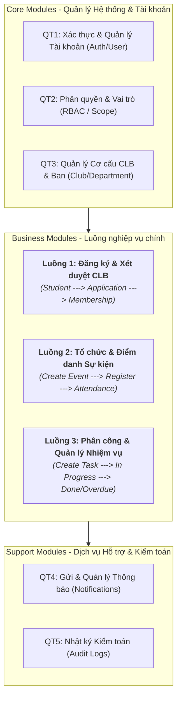
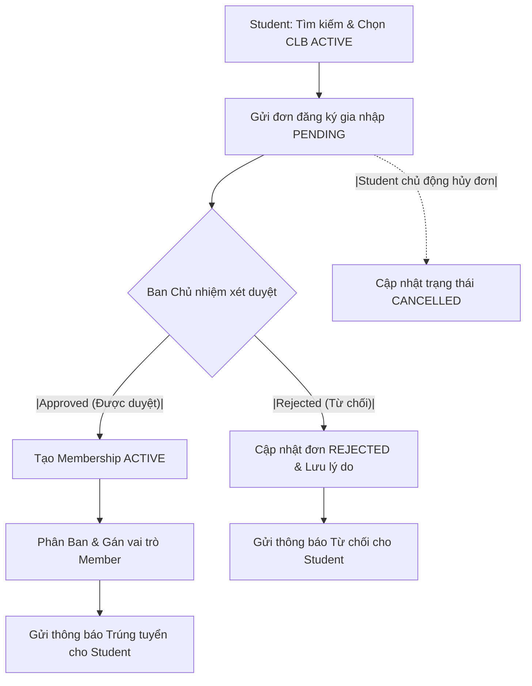
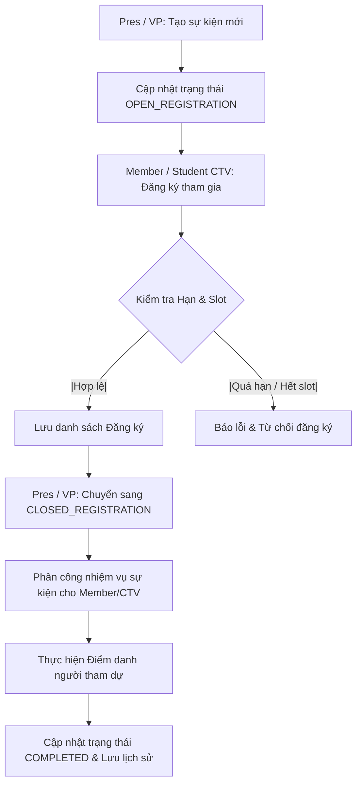
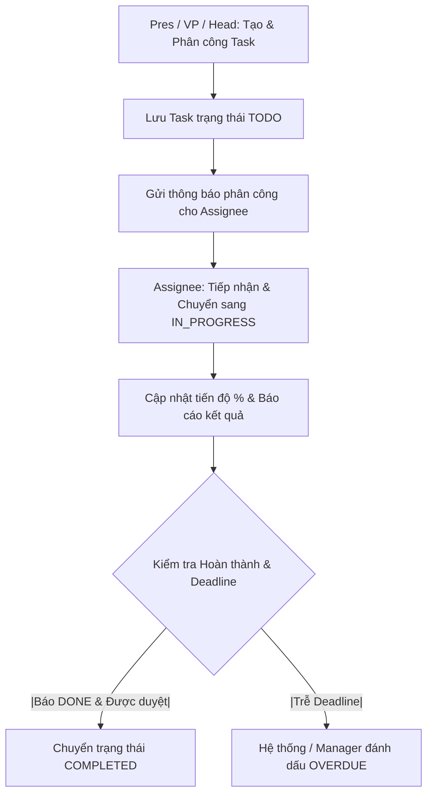

# TÀI LIỆU ĐẶC TẢ HỆ THỐNG QUẢN LÝ CÂU LẠC BỘ SINH VIÊN VJU (CLUB-BASIC-VJU)

---

## 1. Giới thiệu tổng quan

### 1.1 Mục đích tài liệu

Tài liệu này cung cấp đặc tả hệ thống hoàn chỉnh cho **Hệ thống Quản lý Câu lạc bộ Sinh viên Trường Đại học Việt Nhật (VJU)**. Tài liệu đóng vai trò làm căn cứ kỹ thuật cho đội ngũ phát triển (Developers), kiểm thử (Testers), và Ban quản lý hệ thống nhằm nắm rõ các yêu cầu chức năng, mô hình phân quyền, quy trình nghiệp vụ, kiến trúc dự án và các tiêu chuẩn phi chức năng.

### 1.2 Phạm vi hệ thống

Hệ thống giải quyết bài toán quản lý tập trung toàn bộ hoạt động của các câu lạc bộ (CLB) sinh viên VJU (như VJUA), thay thế cho việc sử dụng các công cụ rời rạc như Google Forms, Google Sheets, Facebook và Messenger.
Các phân hệ chính bao gồm:

- Quản lý tài khoản & người dùng hệ thống.
- Khám phá CLB, gửi đơn đăng ký gia nhập và xét duyệt tuyển thành viên.
- Quản lý cơ cấu tổ chức CLB, phân ban và quản lý trạng thái Membership.
- Quản lý & tổ chức sự kiện, mở/đóng đăng ký và điểm danh thành viên/cộng tác viên (CTV).
- Phân công, theo dõi tiến độ và quản lý nhiệm vụ (Task management).
- Hệ thống thông báo in-app và ghi nhật ký kiểm toán (Audit log).

### 1.3 Công nghệ sử dụng

- **Backend:** Java 21, Spring Boot 4.1.1 (Spring Web MVC, Spring Security, OAuth2 Resource Server, Spring Data JPA, Bean Validation).
- **Cơ sở dữ liệu & Migration:** PostgreSQL 16, Flyway.
- **Xác thực & Bảo mật:** JWT HS256 (Nimbus), BCrypt password hashing, Cookie phiên HttpOnly `CLUB_SESSION`, CSRF Protection (`X-XSRF-TOKEN`).
- **Tài liệu API:** OpenAPI 3.1, springdoc / Swagger UI.
- **Frontend:** Next.js 16, React 19, TypeScript, pnpm.
- **Kiểm thử (Testing):** JUnit 5, Mockito, Spring MockMvc trên PostgreSQL thật (Testcontainers), Python unittest cho API contract.
- **Hạ tầng & CI/CD:** Docker, Docker Compose, GitHub Actions.

### 1.4 Từ điển thuật ngữ

| Thuật ngữ / Abbreviation       | Định nghĩa / Giải thích                                                                                                        |
| :----------------------------- | :----------------------------------------------------------------------------------------------------------------------------- |
| **System Admin**               | Quản trị viên cấp cao nhất của hệ thống, quản lý tài khoản và phân quyền toàn hệ thống.                                        |
| **President / Vice President** | Chủ nhiệm / Phó chủ nhiệm CLB, quản lý toàn bộ hoạt động trong phạm vi CLB.                                                    |
| **Head (Department Head)**     | Trưởng ban (Truyền thông, Chuyên môn, Hậu cần, Đối ngoại...), quản lý thành viên và công việc trong ban.                       |
| **Member**                     | Thành viên chính thức của câu lạc bộ.                                                                                          |
| **Student / CTV**              | Sinh viên chưa phải thành viên chính thức, có thể khám phá CLB, nộp đơn đăng ký hoặc tham gia sự kiện dưới dạng Cộng tác viên. |
| **Scope (Phạm vi quyền)**      | Phạm vi áp dụng của quyền/vai trò: `GLOBAL` (toàn hệ thống), `CLUB` (cấp CLB), `DEPARTMENT` (cấp ban).                         |
| **Membership**                 | Bản ghi ghi nhận quá trình tham gia CLB của sinh viên, lưu trữ lịch sử gia nhập/rời CLB.                                       |
| **Audit Log**                  | Nhật ký ghi lại các thao tác nghiệp vụ quan trọng phục vụ kiểm tra và giám sát.                                                |
| **RFC 7807 (Problem Detail)**  | Chuẩn định dạng báo lỗi HTTP thống nhất trong API response.                                                                    |

---

## 2. Mô hình phân quyền

### 2.1 Các vai trò trong hệ thống

1. **System Admin (Quản trị hệ thống):** Scope `GLOBAL`. Quản lý tài khoản, cấu hình vai trò, xem trạng thái hệ thống và tra cứu Audit log toàn hệ thống.
2. **President (Chủ nhiệm CLB):** Scope `CLUB`. Quyền cao nhất trong CLB; duyệt đơn tuyển thành viên, quản lý cơ cấu ban, tạo sự kiện, giao task cho Head/Member, điểm danh, gửi thông báo toàn CLB.
3. **Vice President (Phó chủ nhiệm CLB):** Scope `CLUB`. Hỗ trợ President xét duyệt đơn, quản lý sự kiện, phân công task, theo dõi tiến độ, điểm danh và gửi thông báo.
4. **Head (Trưởng ban):** Scope `DEPARTMENT`. Quản lý ban phụ trách; nhận task từ Pres/VP, tạo subtask, giao việc cho Member trong ban, theo dõi tiến độ, hỗ trợ điểm danh & gửi thông báo ban.
5. **Member (Thành viên CLB):** Scope `CLUB`. Đăng ký tham gia sự kiện, nhận và cập nhật tiến độ task được giao, xem thông báo, điểm danh và cập nhật hồ sơ cá nhân.
6. **Student (Sinh viên / CTV):** Xem danh sách CLB, gửi/hủy đơn gia nhập CLB, đăng ký tham gia sự kiện mở dành cho CTV, xem lịch sử cá nhân.

### 2.2 Ma trận quyền chức năng

_(Ghi chú: **X** = Có quyền truy cập/thực hiện; **O** = Giới hạn theo phạm vi phân công/cá nhân)_

| Nhóm chức năng / Chức năng cụ thể                   | System Admin | President | Vice President | Head  | Member | Student |
| :-------------------------------------------------- | :----------: | :-------: | :------------: | :---: | :----: | :-----: |
| **1. Quản trị Tài khoản & Hệ thống**                |              |           |                |       |        |         |
| - Tạo / Khóa / Mở khóa / Đặt lại mật khẩu tài khoản |    **X**     |           |                |       |        |         |
| - Quản lý Vai trò & Cấp/Thu hồi Quyền hệ thống      |    **X**     |           |                |       |        |         |
| - Tra cứu Audit Log hệ thống                        |    **X**     |           |                |       |        |         |
| **2. Quản lý Câu lạc bộ & Ban**                     |              |           |                |       |        |         |
| - Tạo mới / Bật / Tắt hoạt động CLB                 |    **X**     |           |                |       |        |         |
| - Cập nhật thông tin CLB                            |              |   **X**   |                |       |        |         |
| - Tạo / Sửa / Bật / Tắt Ban trong CLB               |              |   **X**   |     **X**      |       |        |         |
| **3. Tuyển dụng & Quản lý Thành viên**              |              |           |                |       |        |         |
| - Xem danh sách CLB & Gửi đơn gia nhập CLB          |              |           |                |       |        |  **X**  |
| - Xem & Theo dõi / Hủy đơn đăng ký cá nhân          |              |           |                |       |        |  **X**  |
| - Xem danh sách đơn đăng ký CLB                     |              |   **X**   |     **X**      |       |        |         |
| - Duyệt (Approve) / Từ chối (Reject) đơn gia nhập   |              |   **X**   |     **X**      |       |        |         |
| - Thêm / Xóa / Tạm dừng Membership                  |              |   **X**   |     **X**      |       |        |         |
| - Phân / Chuyển ban cho Thành viên                  |              |   **X**   |     **X**      | **O** |        |         |
| - Xem danh sách thành viên CLB / Ban                |              |   **X**   |     **X**      | **X** | **X**  |         |
| **4. Quản lý Sự kiện (Event)**                      |              |           |                |       |        |         |
| - Tạo sự kiện / Chỉnh sửa / Mở & Đóng đăng ký / Hủy |              |   **X**   |     **X**      |       |        |         |
| - Đăng ký tham gia sự kiện (Diện Member / CTV)      |              |           |                |       | **X**  |  **X**  |
| - Xem danh sách người đăng ký sự kiện               |              |   **X**   |     **X**      | **X** |        |         |
| - Thực hiện điểm danh sự kiện                       |              |   **X**   |     **X**      | **O** |        |         |
| **5. Quản lý Nhiệm vụ (Task)**                      |              |           |                |       |        |         |
| - Tạo Task & Phân công cho Head / Member / CTV      |              |   **X**   |     **X**      | **O** |        |         |
| - Xem Task được giao & Cập nhật tiến độ             |              |   **X**   |     **X**      | **X** | **X**  |  **O**  |
| - Đánh giá / Xác nhận hoàn thành Task               |              |   **X**   |     **X**      | **X** |        |         |
| **6. Thông báo & Hồ sơ cá nhân**                    |              |           |                |       |        |         |
| - Gửi thông báo (Toàn CLB / Ban / Sự kiện / Task)   |              |   **X**   |     **X**      | **O** |        |         |
| - Nhận thông báo & Cập nhật hồ sơ cá nhân           |    **X**     |   **X**   |     **X**      | **X** | **X**  |  **X**  |

---

## 3. Tổng quan quy trình nghiệp vụ

### 3.1 Sơ đồ tổng quan các quy trình (Module Diagram)

Dưới đây là sơ đồ tổng quan thể hiện cấu trúc 3 luồng nghiệp vụ chính của hệ thống:



---

### 3.2 Sơ đồ chi tiết các nghiệp vụ (Flowcharts)

#### Flowchart 1: Luồng Đăng ký và Xét duyệt gia nhập CLB



#### Flowchart 2: Luồng Tổ chức và Điểm danh Sự kiện



#### Flowchart 3: Luồng Phân công và Quản lý Nhiệm vụ (Task)



---

## 4. Đặc tả chi tiết các testcase

Dưới đây là usecase/testcase description chi tiết cho 10 chức năng cốt lõi thuộc 3 luồng nghiệp vụ trên:

### 4.1 Luồng 1: Đăng ký gia nhập CLB

#### Bảng TC01: Tìm kiếm và xem thông tin Câu lạc bộ

| Mục                | Nội dung đặc tả                                                                                                                                                                                                                                                                                                                                                      |
| :----------------- | :------------------------------------------------------------------------------------------------------------------------------------------------------------------------------------------------------------------------------------------------------------------------------------------------------------------------------------------------------------------- |
| **Mã Testcase**    | **TC01_CLUB_DISCOVERY**                                                                                                                                                                                                                                                                                                                                              |
| **Tên Testcase**   | Tìm kiếm và xem thông tin chi tiết Câu lạc bộ                                                                                                                                                                                                                                                                                                                        |
| **Tác nhân**       | Student (Sinh viên)                                                                                                                                                                                                                                                                                                                                                  |
| **Mô tả**          | Cho phép sinh viên tra cứu danh sách các CLB đang hoạt động, lọc theo tiêu chí và xem thông tin chi tiết.                                                                                                                                                                                                                                                            |
| **Tiền điều kiện** | Sinh viên đã đăng nhập hệ thống thành công.                                                                                                                                                                                                                                                                                                                          |
| **Luồng chính**    | 1. Sinh viên truy cập màn hình Danh sách Câu lạc bộ.<br>2. Hệ thống hiển thị danh sách các CLB có trạng thái ACTIVE.<br>3. Sinh viên nhập từ khóa tìm kiếm (tên CLB, mã CLB) hoặc chọn lọc theo danh mục.<br>4. Hệ thống trả về danh sách CLB khớp với bộ lọc.<br>5. Sinh viên chọn một CLB để xem thông tin chi tiết (Giới thiệu, Cơ cấu ban, Hoạt động tiêu biểu). |
| **Luồng thay thế** | 3a. Sinh viên không nhập từ khóa tìm kiếm: Hệ thống hiển thị tất cả các CLB ACTIVE phân trang.                                                                                                                                                                                                                                                                       |
| **Luồng ngoại lệ** | 4a. Không tìm thấy CLB phù hợp: Hệ thống hiển thị thông báo "Không tìm thấy câu lạc bộ nào phù hợp".                                                                                                                                                                                                                                                                 |
| **Hậu điều kiện**  | Sinh viên xem được thông tin CLB mong muốn.                                                                                                                                                                                                                                                                                                                          |

#### Bảng TC02: Gửi đơn đăng ký gia nhập CLB

| Mục                | Nội dung đặc tả                                                                                                                                                                                                                                                                                                                                                                                                                                                      |
| :----------------- | :------------------------------------------------------------------------------------------------------------------------------------------------------------------------------------------------------------------------------------------------------------------------------------------------------------------------------------------------------------------------------------------------------------------------------------------------------------------- |
| **Mã Testcase**    | **TC02_APPLICATION_CREATE**                                                                                                                                                                                                                                                                                                                                                                                                                                          |
| **Tên Testcase**   | Gửi đơn đăng ký gia nhập Câu lạc bộ                                                                                                                                                                                                                                                                                                                                                                                                                                  |
| **Tác nhân**       | Student (Sinh viên)                                                                                                                                                                                                                                                                                                                                                                                                                                                  |
| **Mô tả**          | Cho phép sinh viên gửi đơn xin gia nhập vào một CLB cụ thể.                                                                                                                                                                                                                                                                                                                                                                                                          |
| **Tiền điều kiện** | Sinh viên đã đăng nhập, chưa là thành viên chính thức của CLB này và chưa có đơn đăng ký PENDING cho CLB này.                                                                                                                                                                                                                                                                                                                                                        |
| **Luồng chính**    | 1. Sinh viên nhấn nút "Đăng ký gia nhập" tại trang chi tiết CLB.<br>2. Hệ thống hiển thị biểu mẫu đăng ký gia nhập (Lý do gia nhập, nguyện vọng phân ban, thông tin liên hệ).<br>3. Sinh viên điền đầy đủ thông tin và nhấn "Gửi đơn".<br>4. Hệ thống kiểm tra ràng buộc duy nhất (không trùng đơn PENDING), lưu đơn đăng ký với trạng thái `PENDING`.<br>5. Hệ thống gửi thông báo in-app đến Ban chủ nhiệm CLB và hiển thị thông báo gửi thành công cho Sinh viên. |
| **Luồng thay thế** | Không có.                                                                                                                                                                                                                                                                                                                                                                                                                                                            |
| **Luồng ngoại lệ** | 4a. Sinh viên đã có đơn PENDING đang chờ duyệt: Hệ thống báo lỗi `APPLICATION_ALREADY_PENDING` (409 Conflict).<br>4b. Sinh viên đã là thành viên chính thức: Hệ thống báo lỗi `ALREADY_CLUB_MEMBER` (409 Conflict).                                                                                                                                                                                                                                                  |
| **Hậu điều kiện**  | Đơn đăng ký gia nhập được tạo thành công ở trạng thái `PENDING`.                                                                                                                                                                                                                                                                                                                                                                                                     |

#### Bảng TC03: Xem danh sách và duyệt / từ chối đơn đăng ký CLB

| Mục                | Nội dung đặc tả                                                                                                                                                                                                                                                                                                                                                                                                                                                             |
| :----------------- | :-------------------------------------------------------------------------------------------------------------------------------------------------------------------------------------------------------------------------------------------------------------------------------------------------------------------------------------------------------------------------------------------------------------------------------------------------------------------------- |
| **Mã Testcase**    | **TC03_APPLICATION_REVIEW**                                                                                                                                                                                                                                                                                                                                                                                                                                                 |
| **Tên Testcase**   | Xem danh sách và duyệt / từ chối đơn đăng ký CLB                                                                                                                                                                                                                                                                                                                                                                                                                            |
| **Tác nhân**       | President (Chủ nhiệm), Vice President (Phó chủ nhiệm)                                                                                                                                                                                                                                                                                                                                                                                                                       |
| **Mô tả**          | Người quản lý CLB xem danh sách các đơn đăng ký đang chờ và thực hiện duyệt (Approve) hoặc từ chối (Reject).                                                                                                                                                                                                                                                                                                                                                                |
| **Tiền điều kiện** | Pres/VP đã đăng nhập và có quyền `application.review`, `application.approve`, `application.reject` trong phạm vi CLB.                                                                                                                                                                                                                                                                                                                                                       |
| **Luồng chính**    | 1. Pres/VP truy cập danh sách đơn đăng ký của CLB.<br>2. Hệ thống hiển thị danh sách các đơn PENDING.<br>3. Pres/VP chọn một đơn để xem chi tiết.<br>4. Pres/VP nhấn "Duyệt đơn" (Approve) và chọn Ban phân công ban đầu.<br>5. Hệ thống cập nhật trạng thái đơn thành `APPROVED`, tự động tạo bản ghi `Membership` (trạng thái ACTIVE) và xếp thành viên vào Ban đã chọn trong cùng 1 Transaction.<br>6. Hệ thống gửi thông báo kết quả gia nhập thành công đến Sinh viên. |
| **Luồng thay thế** | 4a. Pres/VP nhấn "Từ chối" (Reject) và điền lý do.<br>5a. Hệ thống cập nhật trạng thái đơn thành `REJECTED` và gửi thông báo từ chối đến Sinh viên.                                                                                                                                                                                                                                                                                                                         |
| **Luồng ngoại lệ** | 5b. Đơn đăng ký đã bị hủy hoặc đã được xử lý trước đó bởi người khác: Hệ thống báo lỗi `APPLICATION_ALREADY_REVIEWED` (409 Conflict).                                                                                                                                                                                                                                                                                                                                       |
| **Hậu điều kiện**  | Trạng thái đơn chuyển thành APPROVED/REJECTED; sinh viên trở thành Member nếu đơn được duyệt.                                                                                                                                                                                                                                                                                                                                                                               |

#### Bảng TC04: Hủy đơn đăng ký gia nhập CLB

| Mục                | Nội dung đặc tả                                                                                                                                                                                                                                                      |
| :----------------- | :------------------------------------------------------------------------------------------------------------------------------------------------------------------------------------------------------------------------------------------------------------------- |
| **Mã Testcase**    | **TC04_APPLICATION_CANCEL**                                                                                                                                                                                                                                          |
| **Tên Testcase**   | Hủy đơn đăng ký gia nhập CLB                                                                                                                                                                                                                                         |
| **Tác nhân**       | Student (Sinh viên gửi đơn)                                                                                                                                                                                                                                          |
| **Mô tả**          | Cho phép sinh viên hủy đơn đăng ký gia nhập CLB khi đơn vẫn ở trạng thái PENDING.                                                                                                                                                                                    |
| **Tiền điều kiện** | Sinh viên đã gửi đơn đăng ký và đơn đang ở trạng thái `PENDING`.                                                                                                                                                                                                     |
| **Luồng chính**    | 1. Sinh viên truy cập trang "Đơn đăng ký của tôi".<br>2. Sinh viên chọn đơn đăng ký đang ở trạng thái PENDING và nhấn "Hủy đơn".<br>3. Hệ thống hiển thị hộp thoại xác nhận.<br>4. Sinh viên xác nhận hủy.<br>5. Hệ thống cập nhật trạng thái đơn thành `CANCELLED`. |
| **Luồng thay thế** | Không có.                                                                                                                                                                                                                                                            |
| **Luồng ngoại lệ** | 5a. Đơn đã được Ban chủ nhiệm duyệt/từ chối trước khi hủy: Hệ thống báo lỗi `APPLICATION_CANNOT_BE_CANCELLED` (409 Conflict).                                                                                                                                        |
| **Hậu điều kiện**  | Đơn chuyển sang trạng thái CANCELLED; sinh viên có thể nộp đơn mới nếu muốn.                                                                                                                                                                                         |

---

### 4.2 Luồng 2: Tổ chức sự kiện

#### Bảng TC05: Tạo sự kiện mới và mở đăng ký

| Mục                | Nội dung đặc tả                                                                                                                                                                                                                                                                                                                                                                                                                                              |
| :----------------- | :----------------------------------------------------------------------------------------------------------------------------------------------------------------------------------------------------------------------------------------------------------------------------------------------------------------------------------------------------------------------------------------------------------------------------------------------------------- |
| **Mã Testcase**    | **TC05_EVENT_CREATE**                                                                                                                                                                                                                                                                                                                                                                                                                                        |
| **Tên Testcase**   | Tạo sự kiện mới và mở cổng đăng ký                                                                                                                                                                                                                                                                                                                                                                                                                           |
| **Tác nhân**       | President, Vice President                                                                                                                                                                                                                                                                                                                                                                                                                                    |
| **Mô tả**          | Tạo thông tin sự kiện mới của CLB và thiết lập mở đăng ký cho Member / CTV.                                                                                                                                                                                                                                                                                                                                                                                  |
| **Tiền điều kiện** | Người dùng có vai trò President hoặc Vice President của CLB.                                                                                                                                                                                                                                                                                                                                                                                                 |
| **Luồng chính**    | 1. Pres/VP chọn "Tạo sự kiện mới" tại trang Quản lý sự kiện.<br>2. Nhập thông tin sự kiện: Tên sự kiện, Mô tả, Thời gian bắt đầu/kết thúc, Địa điểm, Hạn đăng ký, Bật/Tắt đăng ký cho CTV.<br>3. Nhấn "Tạo và Mở đăng ký".<br>4. Hệ thống kiểm tra tính hợp lệ dữ liệu (thời gian bắt đầu < thời gian kết thúc, hạn đăng ký < thời gian bắt đầu).<br>5. Hệ thống lưu sự kiện với trạng thái `OPEN_REGISTRATION` và gửi thông báo sự kiện mới đến thành viên. |
| **Luồng thay thế** | 3a. Nhấn "Lưu nháp": Hệ thống lưu sự kiện ở trạng thái `DRAFT` (chưa mở đăng ký).                                                                                                                                                                                                                                                                                                                                                                            |
| **Luồng ngoại lệ** | 4a. Thời gian sự kiện hoặc hạn đăng ký không hợp lệ: Hệ thống hiển thị thông báo lỗi Validation Error (400 Bad Request).                                                                                                                                                                                                                                                                                                                                     |
| **Hậu điều kiện**  | Sự kiện được khởi tạo thành công và xuất hiện trên danh sách sự kiện mở đăng ký.                                                                                                                                                                                                                                                                                                                                                                             |

#### Bảng TC06: Đăng ký tham gia sự kiện

| Mục                | Nội dung đặc tả                                                                                                                                                                                                                                  |
| :----------------- | :----------------------------------------------------------------------------------------------------------------------------------------------------------------------------------------------------------------------------------------------- |
| **Mã Testcase**    | **TC06_EVENT_REGISTER**                                                                                                                                                                                                                          |
| **Tên Testcase**   | Đăng ký tham gia sự kiện (Member / CTV)                                                                                                                                                                                                          |
| **Tác nhân**       | Member (Thành viên CLB) hoặc Student (diện CTV)                                                                                                                                                                                                  |
| **Mô tả**          | Thành viên hoặc Sinh viên ngoài CLB đăng ký tham gia vào một sự kiện đang mở đăng ký.                                                                                                                                                            |
| **Tiền điều kiện** | Sự kiện đang ở trạng thái `OPEN_REGISTRATION` và chưa vượt quá deadline đăng ký.                                                                                                                                                                 |
| **Luồng chính**    | 1. Người dùng xem chi tiết sự kiện và nhấn "Đăng ký tham gia".<br>2. Hệ thống kiểm tra tư cách tham gia (Member hoặc Student CTV nếu sự kiện cho phép CTV).<br>3. Hệ thống lưu bản ghi đăng ký sự kiện và gửi thông báo xác nhận cho người dùng. |
| **Luồng thay thế** | 1a. Người dùng nhấn "Hủy đăng ký" trước deadline: Hệ thống cập nhật hủy đăng ký.                                                                                                                                                                 |
| **Luồng ngoại lệ** | 2a. Đã hết hạn đăng ký hoặc sự kiện đã đóng đăng ký: Hệ thống báo lỗi `REGISTRATION_CLOSED` (400 Bad Request).<br>2b. Người dùng đã đăng ký trước đó: Hệ thống báo lỗi `ALREADY_REGISTERED` (409 Conflict).                                      |
| **Hậu điều kiện**  | Bản ghi đăng ký tham gia sự kiện được tạo thành công.                                                                                                                                                                                            |

#### Bảng TC07: Đóng đăng ký sự kiện và thực hiện điểm danh

| Mục                | Nội dung đặc tả                                                                                                                                                                                                                                                                                                                                                                                                                               |
| :----------------- | :-------------------------------------------------------------------------------------------------------------------------------------------------------------------------------------------------------------------------------------------------------------------------------------------------------------------------------------------------------------------------------------------------------------------------------------------- |
| **Mã Testcase**    | **TC07_EVENT_ATTENDANCE**                                                                                                                                                                                                                                                                                                                                                                                                                     |
| **Tên Testcase**   | Đóng đăng ký sự kiện và thực hiện điểm danh người tham gia                                                                                                                                                                                                                                                                                                                                                                                    |
| **Tác nhân**       | President, Vice President, Head (được cấp quyền)                                                                                                                                                                                                                                                                                                                                                                                              |
| **Mô tả**          | Quản lý đóng cổng đăng ký và tiến hành điểm danh người tham dự sự kiện.                                                                                                                                                                                                                                                                                                                                                                       |
| **Tiền điều kiện** | Sự kiện đã diễn ra hoặc đang trong thời gian diễn ra.                                                                                                                                                                                                                                                                                                                                                                                         |
| **Luồng chính**    | 1. Quản lý chuyển trạng thái sự kiện sang `CLOSED_REGISTRATION`.<br>2. Truy cập màn hình "Điểm danh sự kiện".<br>3. Hệ thống hiển thị danh sách tất cả những người đã đăng ký tham gia.<br>4. Quản lý tích chọn trạng thái điểm danh: `PRESENT` (Có mặt), `ABSENT` (Vắng mặt) hoặc `LATE` (Muộn) cho từng người.<br>5. Nhấn "Lưu kết quả điểm danh".<br>6. Hệ thống lưu trạng thái điểm danh và ghi vào lịch sử hoạt động của người tham gia. |
| **Luồng thay thế** | 4a. Quản lý chỉnh sửa lại trạng thái điểm danh của một người dùng trong khoảng thời gian cho phép.                                                                                                                                                                                                                                                                                                                                            |
| **Luồng ngoại lệ** | 5a. Lỗi kết nối CSDL khi lưu điểm danh: Hệ thống báo lỗi và giữ nguyên form điểm danh để người dùng thử lại.                                                                                                                                                                                                                                                                                                                                  |
| **Hậu điều kiện**  | Kết quả điểm danh được ghi nhận đầy đủ vào hệ thống.                                                                                                                                                                                                                                                                                                                                                                                          |

---

### 4.3 Luồng 3: Phân công nhiệm vụ (Task)

#### Bảng TC08: Tạo nhiệm vụ và phân công người phụ trách

| Mục                | Nội dung đặc tả                                                                                                                                                                                                                                                                                                                                                                                                                                                       |
| :----------------- | :-------------------------------------------------------------------------------------------------------------------------------------------------------------------------------------------------------------------------------------------------------------------------------------------------------------------------------------------------------------------------------------------------------------------------------------------------------------------- |
| **Mã Testcase**    | **TC08_TASK_CREATE_ASSIGN**                                                                                                                                                                                                                                                                                                                                                                                                                                           |
| **Tên Testcase**   | Tạo nhiệm vụ mới và phân công người phụ trách                                                                                                                                                                                                                                                                                                                                                                                                                         |
| **Tác nhân**       | President, Vice President, Department Head                                                                                                                                                                                                                                                                                                                                                                                                                            |
| **Mô tả**          | Cho phép quản lý tạo task công việc và giao cho Head, Member hoặc Student CTV trong phạm vi quản lý.                                                                                                                                                                                                                                                                                                                                                                  |
| **Tiền điều kiện** | Tác nhân có vai trò Pres/VP (phạm vi CLB) hoặc Head (phạm vi Ban).                                                                                                                                                                                                                                                                                                                                                                                                    |
| **Luồng chính**    | 1. Người quản lý truy cập Quản lý nhiệm vụ và nhấn "Tạo Task mới".<br>2. Nhập tiêu đề, mô tả task, mức độ ưu tiên (Low, Medium, High), hạn hoàn thành (Deadline), gắn với Sự kiện (nếu có).<br>3. Chọn người phụ trách (Assignee): Head chọn Member thuộc Ban mình; Pres/VP có thể chọn bất kỳ Head/Member/CTV nào trong CLB.<br>4. Nhấn "Giao nhiệm vụ".<br>5. Hệ thống khởi tạo task ở trạng thái `TODO` và tự động gửi thông báo phân công công việc đến Assignee. |
| **Luồng thay thế** | Không có.                                                                                                                                                                                                                                                                                                                                                                                                                                                             |
| **Luồng ngoại lệ** | 3a. Head chọn gán task cho Member ngoài Ban của mình: Hệ thống chặn và thông báo lỗi vi phạm phạm vi quản lý `PERMISSION_SCOPE_MISMATCH`.<br>4a. Deadline nhỏ hơn thời gian hiện tại: Hệ thống hiển thị lỗi Validation Error.                                                                                                                                                                                                                                         |
| **Hậu điều kiện**  | Task được lưu thành công và người phụ trách nhận được thông báo.                                                                                                                                                                                                                                                                                                                                                                                                      |

#### Bảng TC09: Tiếp nhận và cập nhật tiến độ nhiệm vụ

| Mục                | Nội dung đặc tả                                                                                                                                                                                                                                                                                                                                    |
| :----------------- | :------------------------------------------------------------------------------------------------------------------------------------------------------------------------------------------------------------------------------------------------------------------------------------------------------------------------------------------------- |
| **Mã Testcase**    | **TC09_TASK_PROGRESS_UPDATE**                                                                                                                                                                                                                                                                                                                      |
| **Tên Testcase**   | Tiếp nhận và cập nhật tiến độ nhiệm vụ                                                                                                                                                                                                                                                                                                             |
| **Tác nhân**       | Assignee (Head, Member, CTV được giao task)                                                                                                                                                                                                                                                                                                        |
| **Mô tả**          | Người được giao nhiệm vụ xem chi tiết task, chuyển trạng thái sang Đang làm và cập nhật tiến độ.                                                                                                                                                                                                                                                   |
| **Tiền điều kiện** | Người dùng được giao nhiệm vụ và task đang ở trạng thái `TODO` hoặc `IN_PROGRESS`.                                                                                                                                                                                                                                                                 |
| **Luồng chính**    | 1. Người dùng xem danh sách "Nhiệm vụ của tôi" và chọn task cần cập nhật.<br>2. Nhấn "Bắt đầu làm": Hệ thống chuyển trạng thái task từ `TODO` sang `IN_PROGRESS`.<br>3. Người dùng nhập phần trăm hoàn thành, ghi chú tiến độ / link báo cáo và nhấn "Cập nhật".<br>4. Hệ thống lưu lịch sử cập nhật tiến độ và gửi thông báo đến người giao task. |
| **Luồng thay thế** | 3a. Người dùng nhấn "Hoàn thành nhiệm vụ": Trạng thái task chuyển thành `DONE`.                                                                                                                                                                                                                                                                    |
| **Luồng ngoại lệ** | 2a. Người dùng không phải là Assignee cố tình chỉnh sửa task: Hệ thống báo lỗi `PERMISSION_DENIED` (403 Forbidden).                                                                                                                                                                                                                                |
| **Hậu điều kiện**  | Tiến độ nhiệm vụ được cập nhật chính xác trên hệ thống.                                                                                                                                                                                                                                                                                            |

#### Bảng TC10: Báo cáo hoàn thành và kiểm tra nhiệm vụ quá hạn

| Mục                | Nội dung đặc tả                                                                                                                                                                                                                                                                                                        |
| :----------------- | :--------------------------------------------------------------------------------------------------------------------------------------------------------------------------------------------------------------------------------------------------------------------------------------------------------------------- |
| **Mã Testcase**    | **TC10_TASK_OVERDUE_CHECK**                                                                                                                                                                                                                                                                                            |
| **Tên Testcase**   | Báo cáo hoàn thành và kiểm tra nhiệm vụ quá hạn                                                                                                                                                                                                                                                                        |
| **Tác nhân**       | President, VP, Head, Hệ thống (System Cron)                                                                                                                                                                                                                                                                            |
| **Mô tả**          | Xác nhận task đã hoàn thành hoặc hệ thống tự động gắn nhãn Quá hạn khi vượt Deadline.                                                                                                                                                                                                                                  |
| **Tiền điều kiện** | Task đã được tạo và có deadline xác định.                                                                                                                                                                                                                                                                              |
| **Luồng chính**    | 1. Khi Assignee cập nhật trạng thái `DONE`, người giao task xem xét kết quả.<br>2. Người giao task nhấn "Xác nhận hoàn thành".<br>3. Hệ thống khóa task ở trạng thái `COMPLETED`.                                                                                                                                      |
| **Luồng thay thế** | **Luồng tự động kiểm tra quá hạn (Scheduled Job):**<br>1a. Hệ thống chạy Job quét các task có trạng thái `TODO` hoặc `IN_PROGRESS` mà `deadline < Current_Time`.<br>2a. Hệ thống tự động chuyển trạng thái task sang `OVERDUE`.<br>3a. Hệ thống gửi thông báo nhắc nhở "Task quá hạn" đến Assignee và Người giao task. |
| **Luồng ngoại lệ** | Không có.                                                                                                                                                                                                                                                                                                              |
| **Hậu điều kiện**  | Task ghi nhận đúng trạng thái COMPLETED hoặc OVERDUE.                                                                                                                                                                                                                                                                  |

---

## 5. Yêu cầu phi chức năng

### 5.1 Bảo mật & Phân quyền (Security & Authorization)

- **Xác thực:** Dùng JWT HS256 với Access Token có thời hạn 15 phút và Refresh Token có thời hạn 30 ngày (được xoay vòng sau mỗi lần dùng, chỉ lưu dạng Hash SHA-256 trong DB). Cookie phiên HttpOnly `CLUB_SESSION` kết hợp phòng chống tấn công CSRF bằng header `X-XSRF-TOKEN`.
- **Mã hóa mật khẩu:** Mật khẩu lưu trữ bắt buộc được mã hóa bằng thuật toán BCrypt (`@ValidPassword`, độ dài từ 8-72 byte).
- **Mô hình phân quyền dựa trên Phạm vi (Scope-based RBAC):** Kiểm tra quyền theo 3 cấp độ `DEPARTMENT < CLUB < GLOBAL`. Hệ thống hỗ trợ 35+ quyền hạt nhân.
- **Bảo mật dữ liệu & Quyền riêng tư:** Người dùng không có quyền truy cập sẽ nhận phản hồi `403 Forbidden` hoặc `404 Not Found` (để tránh kỹ thuật dò quét Resource ID).

### 5.2 Hiệu năng & Khả năng mở rộng (Performance & Scalability)

- **Giới hạn tần suất (Rate Limiting):** Áp dụng rate limit cho các API nhạy cảm (Đăng nhập, Đăng ký, Refresh token) với tối đa 60 requests/phút per IP/endpoint. Trả về HTTP `429 Rate Limit Exceeded` khi vi phạm.
- **Tối ưu hóa Cơ sở dữ liệu:** Tạo Index cho tất cả các cột Khóa ngoại (FK), Unique index không phân biệt hoa thường `lower(...)` cho email, mã sinh viên, mã CLB và tên ban; Partial unique index cho đơn đăng ký PENDING.
- **Phân trang:** Mọi API danh sách đều áp dụng phân trang tiêu chuẩn với `offset` (mặc định 0) và `limit` (tối đa 100).

### 5.3 Tính toàn vẹn dữ liệu & Kiểm toán (Data Integrity & Auditability)

- **Ràng buộc cứng tầng DB:** Đặt CHECK constraints, FK composite constraints, và Triggers tầng PostgreSQL đảm bảo dữ liệu luôn hợp lệ ngay cả khi truy vấn trực tiếp bằng SQL.
- **Nhật ký kiểm toán bất biến (Audit Log):** Mọi hành vi quan trọng (Khóa/Mở tài khoản, Tạo/Sửa CLB/Ban, Duyệt đơn, Cấp/Thu hồi quyền) đều được ghi nhận vào bảng `audit_logs` (chỉ cho phép thêm, không sửa/xóa).
- **Xử lý lỗi chuẩn mực:** Mọi lỗi hệ thống được đóng gói theo chuẩn RFC 7807 (`application/problem+json`) với mã lỗi `code` ổn định.

### 5.4 Độ tin cậy & Kiểm thử (Reliability & Testability)

- **Xử lý Transaction:** Các thao tác tạo bản ghi liên quan (như Duyệt đơn -> Tạo Membership -> Tạo Thông báo) phải thực hiện trong cùng một Database Transaction.
- **Kiểm thử tự động:** Độ bao phủ kiểm thử cao với 494+ backend tests (Unit test, Integration test sử dụng Testcontainers với PostgreSQL thật, API contract test với Python).

---

## 6. Cấu trúc dự án

Dưới đây là cấu trúc thư mục hoàn chỉnh của dự án `club-basic-vju` được sao chép trực tiếp từ tài liệu `README.md`:

```text
.
├── backend/springboot/          # Backend Spring Boot (dịch vụ duy nhất)
│   ├── src/main/java/com/vju/club/
│   │   ├── modules/             # Mỗi tính năng một module (xem cấu trúc module bên dưới)
│   │   │   ├── auth/            # Đăng ký, đăng nhập, JWT, refresh token
│   │   │   ├── user/            # Hồ sơ và quản trị người dùng
│   │   │   ├── club/            # Câu lạc bộ
│   │   │   ├── clubapplication/ # Đơn xin vào CLB, duyệt/từ chối
│   │   │   ├── department/      # Ban
│   │   │   ├── membership/      # Thành viên CLB
│   │   │   ├── departmentmember/# Thành viên ban
│   │   │   ├── permission/      # Cấp/thu hồi quyền, quyền hiệu lực
│   │   │   ├── role/            # Vai trò và gán vai trò
│   │   │   ├── notification/    # Thông báo
│   │   │   └── audit/           # Ghi và tra cứu audit log
│   │   ├── security/            # Kiểm tra quyền, rate limit, filter trạng thái tài khoản
│   │   ├── config/              # Cấu hình ứng dụng: security, JWT, CORS, OpenAPI (không chứa DTO)
│   │   ├── error/               # Xử lý lỗi chung (ProblemDetail)
│   │   ├── common/              # Phân trang (PageResponse, OffsetLimitRequest)
│   │   ├── bootstrap/           # Admin ban đầu và dữ liệu demo (chỉ profile local)
│   │   └── rest/                # API catalog, phục vụ file OpenAPI
│   ├── src/main/resources/
│   │   ├── db/migration/        # Flyway: V1–V6 nền tảng, V7 club applications, V8 notifications, V9 created_by/updated_by
│   │   └── api/                 # Bản copy runtime của OpenAPI và catalog
│   ├── src/test/                # Unit test + integration test
│   └── Dockerfile
├── frontend/nextjs/             # Frontend Next.js: discovery, applications, memberships, management, notifications
├── docs/
│   ├── api/                     # OpenAPI contract (nguồn gốc), catalog, test contract
│   ├── database/                # Hướng dẫn database
│   └── superpowers/             # Spec và kế hoạch thiết kế
├── inf/                         # Chỗ dành cho cấu hình docker/nginx/postgres (chưa dùng)
├── docker-compose.yml           # PostgreSQL cho phát triển (cổng 5432)
├── docker-compose.test.yml      # PostgreSQL cho kiểm thử (cổng 55432, dữ liệu trên tmpfs)
└── .github/workflows/backend.yml
```

Cấu trúc chuẩn của mỗi module bên trong `backend/springboot/src/main/java/com/vju/club/modules/<module>/`:

```text
modules/<module>/
├── controller/          # REST controller: chỉ nhận và trả DTO, không bao giờ để lộ entity
├── service/             # Interface service (API của module)
│   └── impl/            # XxxServiceImpl: nghiệp vụ, kiểm tra quyền, audit
├── dto/
│   ├── request/         # Java record cho request body, kèm Bean Validation
│   └── response/        # Java record cho response, bất biến và không phụ thuộc entity
├── mapper/              # MapStruct: entity → DTO, code sinh lúc compile
├── entity/              # JPA entity, chỉ dùng bên trong service/repository
├── enums/               # Enum dùng chung cho entity, DTO và controller
├── repository/          # Spring Data repository
├── specification/       # JPA Specification cho tìm kiếm động (nếu có)
├── annotation/          # Annotation validation riêng của module
├── exception/           # Exception riêng của module (nếu có), kế thừa ApiException
└── common/              # Hằng số của module
```
